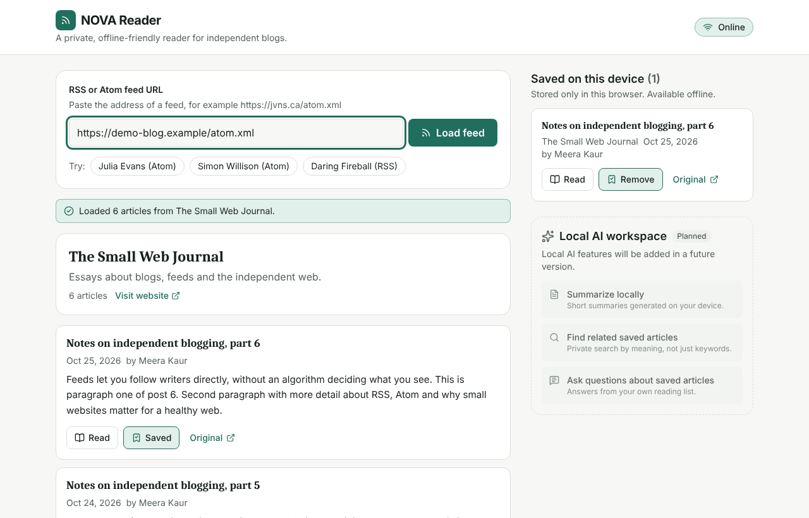
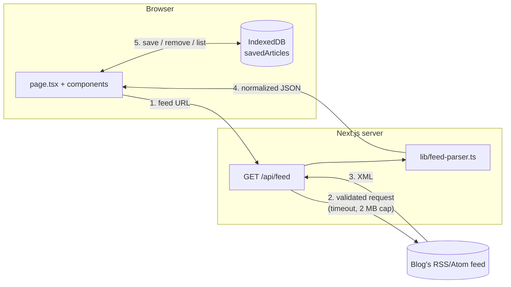

# NOVA Reader

NOVA Reader is a small, privacy-first and offline-friendly reader for RSS and Atom feeds. You paste a feed URL, the app's own server downloads the feed (because browsers block most cross-site feed requests), and the browser shows the articles in a clean list and reading view. Articles you save are stored **only in your browser** (IndexedDB), so they stay available after a refresh and while you are offline. There are no accounts, no tracking and no cloud AI. This is the **first MVP**, built for PECathon 2026 (Problem PS-003, "Small Web Reader"). It is a learning-friendly foundation, **not a production-ready product**.

## Screenshot



<!-- Replace docs/screenshot.png with a screenshot of your own deployment before submitting. -->

## Features implemented

- Load any public RSS 2.0, RSS 1.0 or Atom feed by URL.
- URL validation in the browser **and** on the server (http/https only, no localhost or private-network addresses).
- Server route `GET /api/feed` with a 10-second timeout, 2 MB size limit, safe redirect handling and clear error codes.
- Parser that normalizes RSS and Atom into one simple format: dates as ISO strings, relative links resolved, duplicates removed, stable IDs, at most 50 articles.
- Article list with title, date, author, summary and a link to the original.
- Reading view (accessible dialog) showing the text the feed includes.
- Save and remove articles, stored locally with Dexie.js + IndexedDB, persisting across refreshes.
- Online/offline indicator that updates automatically.
- Placeholder panel for future **local** AI features (does nothing yet, sends nothing).
- Responsive layout, light and dark mode, keyboard-accessible controls, visible focus styles.
- 53 automated tests (parser, validation, API route).

## Features planned for later

See [Future GitHub issues](#future-github-issues) below. In short: multiple subscriptions with a unified timeline, read/unread state, feed autodiscovery, full-article extraction with sanitizing, anonymous opt-in discovery, a service worker for full offline loading, and local AI.

## Technology stack

| Purpose | Tool |
| --- | --- |
| Framework | Next.js 16 (App Router) |
| Language | TypeScript (strict mode) |
| Styling | Tailwind CSS 4 |
| Local database | Dexie.js 4 over IndexedDB |
| Validation | Zod 4 |
| XML parsing | fast-xml-parser 5 |
| Icons | Lucide React |
| Linting | ESLint 9 (Next.js config) |
| Tests | Vitest 5 |

## Folder structure

```
nova-reader/
├── app/
│   ├── api/feed/route.ts     # SERVER: downloads + parses a feed, returns JSON
│   ├── layout.tsx            # SERVER: HTML shell, page title
│   ├── page.tsx              # BROWSER: main page, connects everything
│   └── globals.css           # colours, focus styles, Tailwind import
├── components/               # BROWSER: UI pieces
│   ├── FeedForm.tsx          # URL input + example feeds
│   ├── FeedList.tsx          # feed header + list of articles
│   ├── ArticleCard.tsx       # one article: title, date, actions
│   ├── ReaderView.tsx        # reading dialog
│   ├── SavedArticles.tsx     # "Saved on this device" section
│   ├── OfflineIndicator.tsx  # online/offline badge
│   ├── AIWorkspacePlaceholder.tsx  # future local-AI panel (inactive)
│   ├── EmptyState.tsx        # "nothing here yet" box
│   └── StatusMessage.tsx     # loading / success / error message
├── lib/
│   ├── feed-types.ts         # shared TypeScript types
│   ├── feed-parser.ts        # RSS/Atom → Feed (pure function)
│   ├── validation.ts         # URL checks + API response schema (Zod)
│   ├── db.ts                 # BROWSER: IndexedDB via Dexie
│   ├── use-online-status.ts  # BROWSER: online/offline React hook
│   └── utils.ts              # small helpers (hash, html→text, dates)
├── tests/                    # Vitest tests
├── docs/                     # screenshot + file-by-file guide
├── .env.example              # no variables needed yet
└── package.json
```

A beginner-friendly explanation of every file is in [docs/FILE_GUIDE.md](docs/FILE_GUIDE.md).

## Local setup

You need **Node.js 20.9 or newer** (Node 22 LTS recommended) and npm.

```bash
git clone <your-repo-url> nova-reader
cd nova-reader
npm install
npm run dev
```

Open http://localhost:3000. No environment variables are required. `.env.example` explains this.

## Development commands

| Command | What it does |
| --- | --- |
| `npm run dev` | Start the development server with hot reload |
| `npm run build` | Create an optimized production build |
| `npm start` | Run the production build (after `npm run build`) |
| `npm run lint` | Check code style and common mistakes |
| `npm run typecheck` | Check TypeScript types without building |

## Testing commands

```bash
npm test             # run all tests once
npm run test:watch   # re-run tests when files change
```

Tests never use the real internet: the API route tests replace `fetch` with a fake.

## Architecture



1. The user types a URL. `FeedForm` validates it with `validateFeedUrl()`.
2. The browser calls `/api/feed?url=...`. The server validates the URL again, then downloads it with a timeout and a size limit. Each redirect is validated too.
3. `parseFeed()` turns RSS or Atom XML into one `Feed` object. All HTML becomes plain text.
4. The browser checks the JSON shape with Zod and shows the articles.
5. "Save" writes the article to IndexedDB through `lib/db.ts`. Nothing about saved articles goes to the server.

**Note for PS-003:** the official challenge asks for feed parsing to happen in the browser and for the server route to return the raw response only. In this MVP the server parses, which made the first version simpler to test. `lib/feed-parser.ts` is a pure function with no server-only code, so the next step is to make the route return raw XML and call `parseFeed()` in the browser.

## Privacy

- **No accounts and no tracking.** There is no login, no analytics, no cookies set by the app.
- **Saved articles stay on your device** in IndexedDB. The server never receives them.
- **Feed URLs are fetched through the server route.** The blog sees a request from the server, not from you. The server does not store the URL or the feed; it only logs unexpected errors to its own console.
- **No remote images are loaded**, so blogs cannot track who views the article list.
- **No cloud AI is used.** The AI panel is a placeholder only.
- No external fonts or scripts are loaded; the app uses your system fonts.

## Security limitations

Please read this before deploying publicly.

- **SSRF protection is basic.** The app blocks `localhost`, `.local`/`.internal` names and private IP addresses *written in the URL*, and checks every redirect. It does **not** resolve DNS first, so a public domain that points at a private IP (or DNS rebinding) is not blocked. **Production SSRF hardening is still needed** (resolve DNS, check every resolved IP, pin the connection to it).
- **No rate limiting yet.** Anyone could use the route to make many requests. **Rate limiting must be added** before a public launch.
- **Feeds are untrusted.** The app turns feed HTML into plain text and only allows http(s) links, but it **does not guarantee that every feed is safe or valid**. Links still open the original website, which may be unsafe.
- Responses are decoded as UTF-8 only; feeds in other encodings may show wrong characters.
- No Content-Security-Policy header is configured yet.

## Offline behavior

What works offline:

- If the page is already open, saved articles stay visible and readable.
- The offline badge changes to "Offline: saved articles only".
- Trying to load a feed shows a clear error instead of failing silently.

What does **not** work offline yet:

- **Opening or refreshing the page while offline.** There is no service worker yet, so the browser cannot load the app without a connection. Saved articles are still in IndexedDB and appear again once the page loads.
- Loading new feeds (this needs the internet).
- The last loaded feed is not cached; only articles you saved are kept.

Note: the browser's "online" signal only means "connected to a network". A request can still fail on a bad connection, and the app shows an error when that happens.

## Future Local AI Architecture

The goal is AI help (summaries, related articles, questions) that **runs on the user's device**, so article content is not sent to a cloud service by default.

```
page.tsx  ──postMessage──►  ai.worker.ts (Web Worker)
   ▲                           │ loads a small model once (cached by the browser)
   │                           │ runs inference with WebGPU (WASM fallback)
   └──────────postMessage──────┘ returns summary / embeddings / answer
```

1. **Web Worker.** All model work runs in a separate `ai.worker.ts` thread so the page never freezes.
2. **WebGPU inference.** A browser runtime such as WebLLM or Transformers.js runs a small open model on the GPU, with a WASM/CPU fallback for devices without WebGPU.
3. **Opt-in download.** The model (hundreds of MB) is downloaded only after the user clicks "Enable local AI", with the size shown first, then cached by the browser.
4. **Local data only.** The worker reads saved articles from IndexedDB. Embeddings for "related articles" and "ask questions" are stored in a new Dexie table (for example `articleEmbeddings`).
5. **No silent cloud fallback.** If the device cannot run the model, the feature stays off. Any cloud option would need a separate, explicit opt-in.

## Future GitHub issues

1. **Add website-to-feed autodiscovery** — find the feed from a site URL via `<link rel="alternate">`, `/feed`, `/rss.xml`, `/atom.xml`.
2. **Add secure production-grade SSRF protection** — resolve DNS, block private IPs after resolution, pin connections, add rate limiting.
3. **Add article extraction with Readability and sanitization** — fetch the original page, extract with Mozilla Readability, sanitize with DOMPurify, fall back to the feed summary.
4. **Add local WebGPU LLM inference through a Worker** — as described above.
5. **Add private semantic search using local embeddings** — embeddings computed and stored in the browser.
6. **Add anonymous opt-in feed discovery** — submit subscription lists anonymously, rank by popularity + co-subscription, never recommend already-followed feeds.
7. **Add feed health monitoring** — show dead, slow or broken feeds without breaking the timeline.
8. **Add encrypted local data export** — export saved articles (and later OPML) as an encrypted file.

Also needed for the full PS-003 challenge: multiple subscriptions with one chronological timeline, read/unread state, per-feed filtering, a service worker for offline loading, and moving feed parsing to the browser.

## Contributing

1. Fork the repo and create a branch: `git checkout -b feature/short-name`.
2. Make a small, focused change. Add or update tests in `tests/`.
3. Run `npm run lint`, `npm test` and `npm run build`. All must pass.
4. Open a pull request explaining what changed and why.

Please keep code beginner-friendly: small functions, clear names, comments only where they help.

## License

License: _to be decided_. Add a `LICENSE` file (for example MIT) before the first public release.
