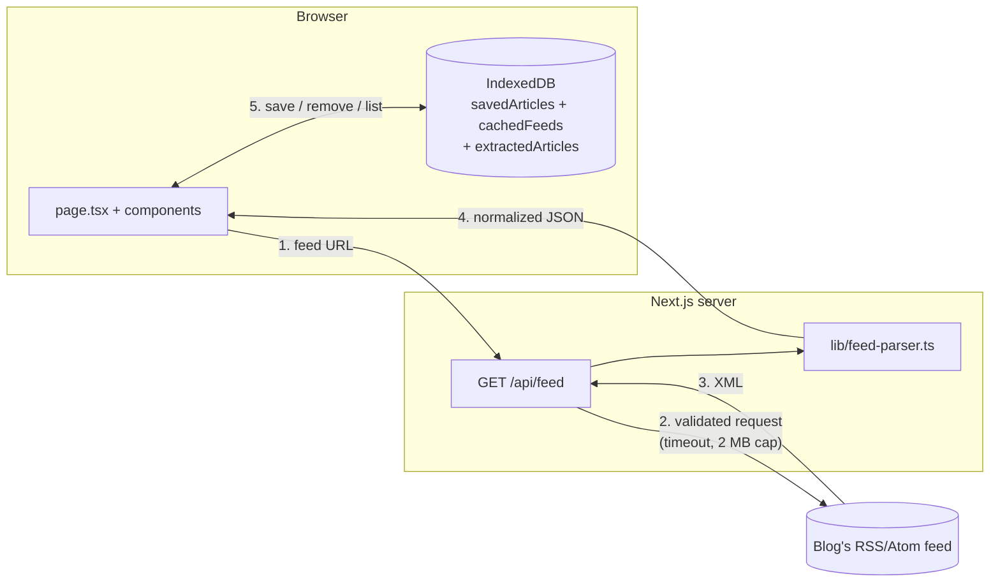

# NOVA Reader

NOVA Reader is a small, privacy-first and offline-friendly reader for RSS and Atom feeds. You paste a feed URL, the app's own server downloads the feed (because browsers block most cross-site feed requests), and the browser shows the articles in a clean list and reading view. Articles you save are stored **only in your browser** (IndexedDB), so they stay available after a refresh and while you are offline. There are no accounts, no tracking and no cloud AI. Built for PECathon 2026 (Problem PS-003, "Small Web Reader"). Current release: **1.0.0-beta.1** — ready for a public beta, but **not yet a hardened production service** (see [Security limitations](#security-limitations) and [docs/DEPLOYMENT.md](docs/DEPLOYMENT.md)).

## Screenshot


<!-- Replace docs/screenshot.png with a screenshot of your own deployment before submitting. -->

## Features implemented

- Load any public RSS 2.0, RSS 1.0 or Atom feed by URL.
- URL validation in the browser **and** on the server (http/https only, no localhost or private-network addresses).
- Server route `GET /api/feed` with SSRF protection (resolved A/AAAA records validated, connections pinned to the validated IPs, every redirect re-checked, web ports only), a 10-second overall timeout, a 2 MB limit (also after decompression), content-type and status checks, charset detection, an in-memory rate-limit placeholder and safe error codes.
- Parser that normalizes RSS and Atom into one simple format: dates as ISO strings, relative links resolved, duplicates removed, stable IDs, at most 50 articles.
- Article list with title, date, author, summary and a link to the original (opens in a new tab with `rel="noopener noreferrer"`).
- Clear loading (disabled button, status message, skeleton), success, empty-feed and error states, with a **Try again** button for errors that may be temporary. Older requests are cancelled when a new one starts, and the browser gives up after 20 seconds.
- Reading view (accessible dialog) showing the feed's content with **working, clearly styled links**. Feed HTML is sanitized with DOMPurify in the browser, relative links are resolved against the article URL, and only http(s) links are kept.
- **Full-article reading view (Stage 6):** opening an article shows the feed text at once, then loads the original page through `GET /api/article` (same SSRF protection as feeds), extracts the main text in the browser with **Mozilla Readability**, and shows it after **DOMPurify** sanitizing. Menus, ads, scripts, images and embeds are removed. A toggle switches between *Full article* and *Feed text*. If extraction fails, a clear reason is shown, the feed text stays, and **Try again** appears when it could help. The original link is always shown. Full articles are stored in IndexedDB (max 50; saved articles' full text is never evicted) so they open offline.
- Save and remove articles, stored locally with Dexie.js + IndexedDB, persisting across refreshes.
- **Offline copies of feeds:** the last 10 feeds you load are stored in IndexedDB. The most recent one appears instantly when you open the app (marked "Offline copy from …") and is refreshed in the background when online. Offline, or when the connection fails, the stored copy is shown instead of an error. A **Clear offline copies** button deletes them (saved articles are kept).
- Clear messages when local storage is full, blocked (e.g. private browsing) or fails.
- **Personal Knowledge Radar (Stage 8, `/radar`):** a private summary of your own reading, calculated in the browser from data already on the device — saved-article count, sources, topics (feed categories + frequent words), articles saved per week, stored reading time and languages of stored full articles. Every chart has a hover/focus tooltip and a *Show as table* view. The radar is not stored and nothing is sent anywhere. It also lists what it **cannot** see (AI summaries, reading history), because the app does not store those.
- Online/offline indicator that updates automatically.
- **Optional local AI (Stage 7):** a *Local AI* panel checks whether the browser can run AI (Web Worker + WebAssembly; WebGPU when available), shows the model, size and source, and downloads the model **only after you click**. Then **Summarize locally** in the reading view summarizes the article **inside your browser** (Web Worker), with download and processing progress, **Stop**, clear errors (unsupported, download failed, out of memory, WebGPU failure → CPU mode), validated plain-text output, and *Turn off* / *Delete downloaded model*. Without AI support everything else works as before.
- Responsive layout, light and dark mode, keyboard-accessible controls, visible focus styles.
- **App opens offline (Stage 9):** a service worker keeps the app pages and code, never your data or API responses.
- Automated tests: 470 unit/component tests (Vitest) and 12 real-browser tests (Playwright: journey, security headers + CSP, accessibility, keyboard, offline).

## Features planned for later

See [Future GitHub issues](#future-github-issues) below. In short: multiple subscriptions with a unified timeline, read/unread state, feed autodiscovery, anonymous opt-in discovery, private semantic search and encrypted export.

## Technology stack

| Purpose | Tool |
| --- | --- |
| Framework | Next.js 16 (App Router) |
| Language | TypeScript (strict mode) |
| Styling | Tailwind CSS 4 |
| Local database | Dexie.js 4 over IndexedDB |
| Validation | Zod 4 |
| HTML sanitizing | DOMPurify 3 (tests use jsdom) |
| Article extraction | Mozilla Readability 0.6 (in the browser) |
| Local AI (optional) | Transformers.js 4.3.1 (ONNX Runtime Web: WebGPU or WebAssembly) in a Web Worker |
| XML parsing | fast-xml-parser 5 |
| Icons | Lucide React |
| Linting | ESLint 9 (Next.js config) |
| Tests | Vitest 5 |

## Folder structure

```
nova-reader/
├── app/
│   ├── api/feed/route.ts     # SERVER: thin route, calls lib/server/feed-handler.ts
│   ├── api/article/route.ts  # SERVER: thin route, calls lib/server/article-handler.ts
│   ├── layout.tsx            # SERVER: HTML shell, page title
│   ├── page.tsx              # BROWSER: main page, connects everything
│   ├── radar/page.tsx        # BROWSER: Personal Knowledge Radar (Stage 8)
│   ├── error.tsx, global-error.tsx, not-found.tsx  # Stage 9 error pages
│   ├── api/[...path]/route.ts # SERVER: JSON 404 for unknown API paths (Stage 9)
│   └── globals.css           # colours, focus styles, Tailwind import
├── components/               # BROWSER: UI pieces
│   ├── FeedForm.tsx          # URL input + example feeds
│   ├── FeedList.tsx          # feed header + list of articles
│   ├── ArticleCard.tsx       # one article: title, date, actions
│   ├── ReaderView.tsx        # reading dialog
│   ├── ArticleContent.tsx    # sanitized article HTML with links
│   ├── SavedArticles.tsx     # "Saved on this device" section
│   ├── OfflineIndicator.tsx  # online/offline badge
│   ├── OfflineCopies.tsx     # count of offline feed copies + clear button
│   ├── AIWorkspace.tsx       # Local AI panel: support, download, progress, errors
│   ├── LocalAiProvider.tsx   # shared local AI state (one worker for the page)
│   ├── LocalSummary.tsx      # "Summarize locally" in the reading view
│   ├── radar/                # StatTile, BarList, WeeklyColumns, DataTable (Stage 8)
│   ├── EmptyState.tsx        # "nothing here yet" box
│   └── StatusMessage.tsx     # loading / success / error message
├── lib/
│   ├── feed-types.ts         # shared TypeScript types
│   ├── feed-parser.ts        # RSS/Atom → Feed (pure function)
│   ├── validation.ts         # URL checks + API response schema (Zod)
│   ├── api-request.ts        # BROWSER: shared API caller (timeout, cancel, Zod check)
│   ├── feed-client.ts        # BROWSER: calls /api/feed
│   ├── article-client.ts     # BROWSER: calls /api/article
│   ├── article-extractor.ts  # BROWSER: Readability on an inert, cloned document
│   ├── use-article-extraction.ts # BROWSER: stored copy → download → extract → store
│   ├── db.ts                 # BROWSER: IndexedDB via Dexie
│   ├── sanitize-html.ts      # BROWSER: DOMPurify + safe links
│   ├── use-online-status.ts  # BROWSER: online/offline React hook
│   ├── utils.ts              # small helpers (hash, html→text, dates)
│   ├── radar.ts              # BROWSER-safe pure radar calculations (Stage 8)
│   └── server/               # SERVER ONLY (import "server-only")
│       ├── feed-handler.ts   # the /api/feed logic: rate limit → validate → fetch → parse
│       ├── article-handler.ts # the /api/article logic: rate limit → validate → fetch (no parsing)
│       ├── responses.ts      # shared JSON + security headers
│       ├── feed-fetcher.ts   # shared safe download loop: redirects, status, content type, charset
│       ├── http-client.ts    # one GET with pinned DNS, timeout, size limit, decompression
│       ├── ssrf.ts           # IP policy, DNS validation, pinned lookup, port policy
│       ├── rate-limit.ts     # RateLimiter interface + in-memory MVP placeholder
│       └── errors.ts         # safe, user-facing error type
├── lib/ai/                   # Stage 7: config, capabilities, protocol, text checks, client, worker logic
├── workers/ai.worker.ts      # Stage 7: the AI Web Worker (Transformers.js)
├── scripts/copy-onnx-wasm.mjs # copies the ONNX Runtime engine into public/ort/ (dev + build)
├── tests/                    # Vitest tests
├── e2e/                      # Playwright browser tests (Stage 9)
├── public/sw.js              # service worker: app opens offline (Stage 9)
├── .github/workflows/ci.yml  # CI: audit, check, e2e (Stage 9)
├── docs/                     # FILE_GUIDE, SECURITY, PRIVACY, DEPLOYMENT, BROWSER_SUPPORT,
│                             # RELEASE_CHECKLIST, HANDOFF (Stage 9–10), screenshot
├── CHANGELOG.md              # release notes (Stage 10)
├── .env.example              # no variables needed
└── package.json
```

A beginner-friendly explanation of every file is in [docs/FILE_GUIDE.md](docs/FILE_GUIDE.md).

## Local setup

You need **Node.js 20.9 or newer** (Node 22 LTS recommended) and npm.

```bash
git clone <your-repo-url> nova-reader
cd nova-reader
npm install
npm run dev
```

Open http://localhost:3000. No environment variables are required. `.env.example` explains this.

Notes: `.npmrc` sets `onnxruntime-node-install=skip` (a server-only optional download that the browser AI does not need). `npm run dev` and `npm run build` first copy the ONNX Runtime engine files into `public/ort/` (ignored by git).

## Development commands

| Command | What it does |
| --- | --- |
| `npm run dev` | Start the development server with hot reload |
| `npm run build` | Create an optimized production build |
| `npm start` | Run the production build (after `npm run build`) |
| `npm run lint` | Check code style and common mistakes |
| `npm run typecheck` | Check TypeScript types without building |
| `npm run check` | Lint + typecheck + unit tests + build (what CI runs first) |
| `npm run test:e2e` | Browser tests with Playwright (builds and starts the app). First time: `npx playwright install chromium` |

## Testing commands

```bash
npm test             # run all tests once
npm run test:run     # same, explicit name
npm run test:watch   # re-run tests when files change
npm run test:e2e     # real-browser tests: smoke, security headers + CSP, no third-party requests,
                     # axe accessibility (light + dark), keyboard, offline via service worker
```

Frontend tests (`tests/home-page.test.tsx`) render the real page in jsdom with React Testing Library and a fake `fetch`; `fake-indexeddb` stands in for the browser database.

Tests never use the real internet. Route tests use a fake DNS resolver and a fake network that still runs the real SSRF checks; `tests/http-client.test.ts` uses a real local HTTP server for timeouts, size limits and gzip bombs.

## Architecture



1. The user types a URL. `FeedForm` validates it with `validateFeedUrl()`.
2. The browser calls `/api/feed?url=...`. The server validates the URL again, then downloads it with a timeout and a size limit. Each redirect is validated too.
3. `parseFeedXml()` turns RSS or Atom XML into one `Feed` object. Titles and summaries become plain text. If the feed content contains HTML, it is also kept unchanged as `contentHtml` (untrusted; the server never renders it).
4. The browser checks the JSON shape with Zod and shows the articles.
5. "Save" writes the article (including `contentHtml`) to IndexedDB through `lib/db.ts`. Every successfully loaded feed is also stored as an offline copy (`cachedFeeds`, max 10). Nothing in IndexedDB is ever sent to the server.
6. The reading view passes `contentHtml` through `sanitizeArticleHtml()` (DOMPurify allow-list + link checks) **every time it is displayed**, then inserts the cleaned DOM nodes. `dangerouslySetInnerHTML` is not used.

**Note for PS-003:** the official challenge asks for feed parsing to happen in the browser and for the server route to return the raw response only. In this MVP the server parses, which made the first version simpler to test. `lib/feed-parser.ts` is a pure function with no server-only code, so the next step is to make the route return raw XML and call `parseFeedXml()` in the browser.

### Article extraction (Stage 6)

```
Reader opens ─► stored full article in IndexedDB? ──yes──► show it (works offline)
                     │ no
                     ▼
     GET /api/article?url=…  (server: same SSRF checks, redirects, 10 s, 3 MB, HTML only;
                     │        returns raw HTML INSIDE JSON, never as a web page; no parsing)
                     ▼
     DOMParser (inert: no scripts, no images) → clone → Readability.parse()
                     ▼
     store in IndexedDB ─► DOMPurify allow-list + safe links ─► reading view
```

Why extraction is in the browser: the PS-003 brief says the fetch route must not parse content, parsing untrusted HTML on the server would need jsdom (bigger attack surface), and the browser's `DOMParser` creates documents that never run scripts or load resources.

### Personal Knowledge Radar (Stage 8)

| What is shown | Based on (stored locally) |
| --- | --- |
| Saved articles, sources | `savedArticles` (feed title, or the website's host name) |
| Topics | Feed **categories** of saved articles (from `cachedFeeds`, only while that feed is cached) **or** words that appear in titles, summaries and stored full text. Counted per article. Common English words are removed. With 5+ saved articles a word must appear in 2+ articles |
| Articles saved per week | `savedArticles.savedAt`, last 8 weeks, weeks start on Monday (local time) |
| Full articles, reading time | `extractedArticles` — words counted from the stored text, 200 words per minute |
| Languages | `extractedArticles.lang`, as declared by each page |
| **Not shown (not stored)** | Local AI summaries, reading time, a history of opened articles, categories of saved articles whose feed is no longer cached |

Charts are plain SVG/HTML (no chart library): one validated colour (`--chart-mark`, light `#0b7d62`, dark `#22a982`, checked with a palette validator for lightness, chroma and 3:1 contrast), thin bars with 4px rounded ends, values at bar tips, hover **and** keyboard-focus tooltips, and a table view. The weekly chart is drawn at the container's real width so its text stays readable on phones.

## Privacy

- **No accounts and no tracking.** There is no login, no analytics, no cookies set by the app.
- **Saved articles and offline feed copies stay on your device** in IndexedDB. The server never receives them. Anyone using the same browser profile can see them; use **Clear offline copies** and **Remove** to delete them.
- **Feed URLs are fetched through the server route.** The blog sees a request from the server, not from you. The server does not store the URL or the feed; it only logs unexpected errors to its own console.
- **No remote images are loaded**, so blogs cannot track who views the article list.
- **The radar is computed on demand** in the browser and not saved; it makes no network requests.
- **No cloud AI is used.** Local AI runs in a Web Worker in your browser; article text is never sent anywhere. Turning it on downloads the model files once from **huggingface.co** (Hugging Face sees your IP address and which model was downloaded — not what you read). The ONNX Runtime engine is served from this app (`/ort/`), not a third-party CDN.
- No external fonts or scripts are loaded; the app uses your system fonts.

## Security limitations

Please read this before deploying publicly.

- **SSRF protection is an MVP foundation, not a guarantee.** What is implemented (`lib/server/ssrf.ts`):
  - Only `http:`/`https:`, no credentials, ports 80/443/8080/8443 only.
  - Hostnames are resolved (A **and** AAAA via the OS resolver). The request is refused if **any** address is loopback, private, link-local, cloud-metadata, carrier-grade NAT, multicast, reserved, documentation, IPv4-mapped/NAT64/6to4/Teredo IPv6, or otherwise not public.
  - The validated addresses are handed to Node's HTTP client as its DNS `lookup`, so the connection goes to exactly the address that was checked (this defeats classic DNS rebinding / TOCTOU between check and connect).
  - Redirects are followed manually (max 3); every target gets the full check again.
- **SSRF limits that code alone cannot solve here:**
  - **No network-level egress control.** The real fix is a firewall/egress proxy that only allows public internet. Serverless hosts (e.g. Vercel) do not let this app configure that; on a VPS or container, add firewall rules that block private ranges and `169.254.169.254`.
  - **HTTP proxies.** If the server is configured to use an outbound proxy (`HTTP_PROXY`), the proxy resolves DNS itself and our pinning does not apply. The app does not use a proxy by default; do not add one without the same checks in the proxy.
  - **IPv6/IPv4 translation on the host network** (e.g. NAT64 gateways or unusual routing) can make a "public" address reach something internal. Only network controls can rule this out.
  - **The resolver is trusted.** We rely on the OS resolver's answer; a compromised resolver is out of scope.
  - **Public targets can still be abused.** The route can be used to make requests to any public website (e.g. to hide the caller's IP). Rate limiting reduces, but does not remove, this.
- **Rate limiting is an in-memory placeholder.** 30 requests/minute per client, keyed by a salted hash of the IP (raw IPs are never stored). It works per server instance only and resets on restart; on serverless hosting each instance has its own counter. Client IPs come from `x-forwarded-for`, which is only trustworthy behind a platform that sets it (Vercel does); elsewhere clients can fake it. **Use a shared store (e.g. Redis/Upstash) or a platform firewall in production** by implementing the `RateLimiter` interface.
- **Feeds are untrusted.** Feed HTML is sanitized with DOMPurify (short tag allow-list, no scripts, styles, event handlers, iframes, forms or images) and only http(s) links are kept, but the app **does not guarantee that every feed is safe or valid**. Links open other websites, which may be unsafe.
- **Article pages are untrusted.** The server only downloads them (same SSRF protection as feeds) and returns them as JSON data with `Content-Security-Policy: default-src 'none'`, so they can never run as part of this site. Extraction runs on an inert, cloned document, and output is always sanitized. Readability can still mis-detect the main content (e.g. on pages that need JavaScript, paywalls, or home pages); then the feed text is shown with an explanation.
- **Using the article route reveals reading to the server operator** (which article URL was requested). The server does not store or log URLs, and the blog sees the server, not the reader.
- Feed text is decoded using the Content-Type charset, a byte-order mark or the XML declaration, falling back to UTF-8.
- **Security headers (Stage 9):** every page sends a strict Content-Security-Policy (`default-src 'self'`, no third-party scripts, connections only to this site and Hugging Face, `frame-ancestors 'none'`), `X-Frame-Options: DENY`, `Referrer-Policy: no-referrer`, `Permissions-Policy`, HSTS and COOP; `X-Powered-By` is removed. API responses additionally use `default-src 'none'`. The CSP still allows `'unsafe-inline'` scripts (needed by Next.js static pages). Details and accepted risks: [docs/SECURITY.md](docs/SECURITY.md).
- **Beta, not a hardened production service.** Before a public launch: network egress controls, a shared rate limiter, and the manual checks in [docs/RELEASE_CHECKLIST.md](docs/RELEASE_CHECKLIST.md).

## Offline behavior

What works offline (once the page is open):

- **Saved articles** stay visible and readable, including their links.
- **Offline feed copies:** loading a feed you loaded before shows its stored copy with the notice "You are offline. Showing your offline copy from …". The feed header shows an "Offline copy from …" badge.
- When the page opens, the most recent copy is shown immediately; if online, it is updated in the background ("Updated: …").
- If the server cannot be reached or times out, the stored copy is shown with a **Try again** button.
- The badge changes to "Offline: stored articles only". A feed with no stored copy shows a clear error.

- **Opening and refreshing the app offline (Stage 9):** a service worker (`public/sw.js`, production builds only) keeps the app's own pages and build files, so after one online visit `/` and `/radar` open with no connection. It never stores `/api/*` responses, the AI model or other websites. Your data stays in IndexedDB.

What does **not** work offline:

- Opening the app offline on a device that has never opened it online.
- Loading feeds you have never loaded before.
- Only the last 10 feeds are kept. The browser may also delete site data when the device is low on space (persistent storage is not requested yet).

Note: the browser's "online" signal only means "connected to a network". A request can still fail on a bad connection; the app then falls back to the stored copy when it has one.

## Local AI (Stage 7)

| Question | Answer |
| --- | --- |
| Library | **Transformers.js** `@huggingface/transformers` 4.3.1 (runs ONNX models with ONNX Runtime Web). |
| Model | **`Xenova/t5-small`** (Apache-2.0), task *summarization*. Small enough for mid-range phones; summaries are basic and can be wrong. Change it in `lib/ai/config.ts`. |
| Download size | CPU / WebAssembly, 8-bit (`q8`): **about 80 MB**. WebGPU, 16-bit (`fp16`, only if the GPU supports `shader-f16`): **about 156 MB**. Plus the ONNX Runtime engine (14–27 MB) from this app. |
| Where from | Public **Hugging Face Hub** (huggingface.co), **only after the user clicks** “Download & enable local AI”. |
| Where cached | The browser's **Cache Storage** (`transformers-cache`) for this site. “Delete downloaded model” removes it. |
| Browser features | Required: **Web Workers** and **WebAssembly**. Optional: **WebGPU** (`navigator.gpu`, a GPU adapter with `shader-f16`, and a secure context: HTTPS or localhost). |
| When unavailable | The panel explains why. Nothing is downloaded; feeds, saving, offline reading and full articles all work as before. |

```
page (main thread)                          workers/ai.worker.ts (Web Worker)
──────────────────                          ─────────────────────────────────
LocalAiProvider ─ load {model, device} ───► Transformers.js pipeline("summarization")
   ▲   (only after the user clicks)            │  downloads model (huggingface.co) → Cache Storage
   │◄──── load-progress / ready ───────────────┘  engine from /ort/ (our site)
LocalSummary ── summarize {text} ─────────► generate (TextStreamer counts tokens)
   ▲                                            │
   │◄──── generate-progress / summary / error ─┘
   └─ every message checked with Zod; summary checked by validateSummary(); shown as plain text
Stop / Cancel → worker.terminate()  (immediate; the model must be loaded again, from the cache)
```

How it stays safe and private:

1. **Explicit action:** no worker is created and nothing is downloaded until the click.
2. **Off the main thread:** all model work runs in the worker, so the page stays responsive.
3. **Local only:** article text goes from the page to the worker and back. There are no AI API calls; tests check that `fetch` is never used with article text.
4. **Validated output:** worker messages are checked with Zod. Summaries must be plain text of sensible length without repetition loops, markup is stripped, and the result is rendered as text, never HTML.
5. **Clear failures:** unsupported browser, download failure, out of memory, WebGPU failure (with a *Use CPU mode* button), crash and timeout (2 minutes) each have their own message.

Limitations: T5-small reads about 2,000 characters, so only the beginning of long articles is summarized (the UI says so). It works best with English. Stopping terminates the worker, so the model reloads from the cache next time. **The real model could not be downloaded in the development sandbox (huggingface.co blocked), so real inference has not been verified yet; please test on a real device.**

## Future GitHub issues

1. **Add website-to-feed autodiscovery** — find the feed from a site URL via `<link rel="alternate">`, `/feed`, `/rss.xml`, `/atom.xml`.
2. ~~Add secure production-grade SSRF protection~~ — code-level protection done in Stage 4/9; still needed: network egress firewall and a shared rate limiter (see docs/SECURITY.md).
3. ~~Add article extraction with Readability and sanitization~~ — done in Stage 6.
4. ~~Add local WebGPU inference through a Worker~~ — foundation done in Stage 7 (summaries).
5. **Add private semantic search using local embeddings** — embeddings computed and stored in the browser.
6. **Add anonymous opt-in feed discovery** — submit subscription lists anonymously, rank by popularity + co-subscription, never recommend already-followed feeds.
7. **Add feed health monitoring** — show dead, slow or broken feeds without breaking the timeline.
8. **Add encrypted local data export** — export saved articles (and later OPML) as an encrypted file.

Also needed for the full PS-003 challenge: multiple subscriptions with one chronological timeline, read/unread state, per-feed filtering, and moving feed parsing to the browser.

## Release readiness (Stage 9)

- **Errors:** one set of stable codes (`lib/app-errors.ts`: `UNKNOWN`, `NETWORK`, `TIMEOUT`, `VALIDATION`, `NOT_FOUND`, `UNAUTHORIZED`, `RATE_LIMITED`, `STORAGE`, `EXTRACTION`, `LOCAL_AI`, `UNSUPPORTED`) that every earlier code maps onto.
  - `app/error.tsx` (Try again + Back to the reader), `app/global-error.tsx` and `app/not-found.tsx`.
  - Unknown `/api/*` paths return the same safe JSON error.
  - Logs are one redacted line: no stack traces, query strings, `KEY=value` secrets, file paths or article text.
- **Security and privacy:** page-wide CSP and security headers (above). An automated test checks for no CSP violations and no requests to other websites. See [docs/SECURITY.md](docs/SECURITY.md) and [docs/PRIVACY.md](docs/PRIVACY.md).
- **Accessibility:** axe-core (WCAG 2.2 AA + best practices) reports 0 violations on home, reader, radar and 404 in light and dark mode. There are skip links on both pages, the reader dialog returns focus, and motion is reduced when the system asks.
- **Performance:**
  - Home-page JavaScript went from about 1.19 MB to 0.91 MB uncompressed (288 KB gzipped), because Zod is now tree-shaken and its translations aren't bundled.
  - Readability loads only when a full article is opened.
  - The AI engine loads only after the user enables it.
- **Offline:** service worker (above).
- **Browsers:** see [docs/BROWSER_SUPPORT.md](docs/BROWSER_SUPPORT.md); `<dialog>` has a fallback; `engines.node >= 20.9`.
- **CI:** `.github/workflows/ci.yml` runs `npm audit`, `npm run check` and `npm run test:e2e`.
- **Checklist:** [docs/RELEASE_CHECKLIST.md](docs/RELEASE_CHECKLIST.md).

## Deployment (Stage 10)

No database, environment variables or secrets are needed. Short version:

- **Vercel:** import the repo (set *Root Directory* to `nova-reader` if it is a sub-folder) and deploy with the defaults.
- **Own server:** `npm ci && npm run build && npm start` behind an HTTPS reverse proxy that sets `X-Forwarded-For`, plus an egress firewall.

Full steps, post-deploy checks and rollback: [docs/DEPLOYMENT.md](docs/DEPLOYMENT.md). Release notes: [CHANGELOG.md](CHANGELOG.md). Handoff and known gaps: [docs/HANDOFF.md](docs/HANDOFF.md).

## Contributing

1. Fork the repo and create a branch: `git checkout -b feature/short-name`.
2. Make a small, focused change. Add or update tests in `tests/`.
3. Run `npm run lint`, `npm test` and `npm run build`. All must pass.
4. Open a pull request explaining what changed and why.

Please keep code beginner-friendly: small functions, clear names, comments only where they help.

## License

License: _to be decided_. Add a `LICENSE` file (for example MIT) before the first public release.
