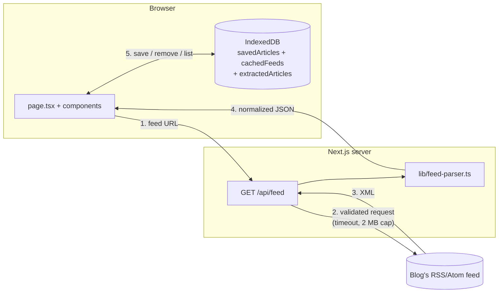

# Stage 10 files — NOVA Reader 1.0.0-beta.1

Complete contents of every file added or changed in Stage 10.

`package-lock.json` also changed, but only its two `"version"` fields (now `1.0.0-beta.1`, set by `npm version`). It isn't repeated here.

| File | Status |
| --- | --- |
| `CHANGELOG.md` | new |
| `docs/DEPLOYMENT.md` | new |
| `docs/HANDOFF.md` | new |
| `docs/RELEASE_CHECKLIST.md` | changed |
| `tests/release-regressions.test.ts` | new |
| `lib/sanitize-html.ts` | changed |
| `package.json` | changed |
| `docs/SECURITY.md` | changed |
| `README.md` | changed |
| `docs/FILE_GUIDE.md` | changed |

## `CHANGELOG.md`

````markdown
# Changelog

## 1.0.0-beta.1 — 2026-10-30 (Stage 10: release candidate)

First public beta. No new user-facing features in this release; it validates and documents Stages 1–9.

- **Security:** the HTML sanitizer now also removes `data-*` attributes (DOMPurify keeps them by default; found by a new regression test).
- **Tests:** 34 new regression tests (`tests/release-regressions.test.ts`):
  - unusual IP spellings: hex, octal, short forms, one big number, trailing dots, IPv4-mapped/compatible IPv6, NAT64, 6to4, zone IDs
  - cloud metadata hosts, blocked ports, backslash/credential tricks, punycode hosts
  - entity-encoded `javascript:` links, SVG/MathML tricks, remote media/`<base>`/`<meta refresh>`, deeply nested HTML
- **Deployment:** `docs/DEPLOYMENT.md` (Vercel and own-server steps, post-deploy checks, rollback).
- **Docs:** README brought up to date (release status, test counts, finished items removed from "planned"); `docs/HANDOFF.md` (status, verified/unverified, next steps); release checklist updated.
- Version set to `1.0.0-beta.1`.

## Stages 1–9 (0.1.0, development)

1. Next.js app shell, feed URL form, project structure.
2. URL validation (browser + server) and safe API error codes.
3. RSS 2.0 / RSS 1.0 / Atom parser with limits.
4. `/api/feed`: SSRF protection (DNS check + pinned connections), timeouts, size limits, rate limiting.
5. Saved articles and offline feed copies in IndexedDB (Dexie).
6. Full-article reader: `/api/article`, Readability, DOMPurify.
7. Optional local AI summaries in a Web Worker (Transformers.js, T5-small).
8. Personal Knowledge Radar (`/radar`), calculated on the device.
9. Production hardening: error pages and codes, redacted logs, CSP and security headers, service worker (opens offline), accessibility fixes (axe: 0 violations), smaller bundle, Playwright tests, CI, security/privacy docs.
````

## `docs/DEPLOYMENT.md`

````markdown
# Deployment guide (beta)

NOVA Reader is a normal Next.js 16 app. It needs **no database, no environment variables and no secrets**. Two ways to host it are described below.

> Tested in the sandbox: a clean `npm ci` → `npm run build` → `npm start` on Node 22, then a check of the security headers, the safe API errors, `/sw.js` and the `/ort/` engine files.
> **Not tested:** an actual Vercel deployment or a real reverse proxy (no access from the sandbox). Do the "After deploying" checks below on the real site.

## Requirements

- Node.js **20.9 or newer** (22 LTS recommended). `package.json` → `engines` says the same.
- npm, using the committed `package-lock.json` (`npm ci`, not `npm install`, on servers).
- **HTTPS.** The service worker (offline mode) and HSTS only work on HTTPS. Plain `http://localhost` is fine for testing.
- Outbound internet access from the server (it downloads the feeds and articles users ask for).

## Option A: Vercel (recommended for the beta)

1. Push the repository to GitHub.
2. In Vercel, choose **Add New → Project** and import the repository.
3. **Root Directory:** if `nova-reader` is a sub-folder of your repository (for example inside `PECathon/`), set Root Directory to `nova-reader`. Otherwise leave it empty.
4. Leave the defaults: Framework **Next.js**, Build command `npm run build`, Install command `npm ci` or automatic. Add **no** environment variables.
5. Deploy. `npm run build` first runs `scripts/copy-onnx-wasm.mjs` (the `prebuild` step), which copies the local-AI engine into `public/ort/`.

Why Vercel fits: it sets `x-forwarded-for` itself, so the rate limiter sees real client IPs, and it serves HTTPS automatically.

## Option B: your own server (Node.js)

```bash
npm ci
npm run build
PORT=3000 npm start        # Windows PowerShell: $env:PORT=3000; npm start
```

Put it behind an HTTPS reverse proxy (for example Caddy or nginx). Two settings matter:

- The proxy must **replace** (not append to) the `X-Forwarded-For` header with the real client IP. Otherwise clients can fake it and get around the rate limit.
- Don't strip the app's response headers (`Content-Security-Policy`, `Strict-Transport-Security` and the others).

Use a process manager (systemd, pm2 or your platform's equivalent) so the server restarts after a crash.

**Firewall (important for self-hosting):** block outbound connections from the server to private ranges (`10.0.0.0/8`, `172.16.0.0/12`, `192.168.0.0/16`, `127.0.0.0/8`, `169.254.0.0/16`, `fc00::/7`, `fe80::/10`). The code already blocks these, but a firewall is the second lock. See `SECURITY.md`.

Don't set `HTTP_PROXY`/`HTTPS_PROXY` for the app process: an outbound proxy bypasses the DNS pinning in `lib/server/ssrf.ts`.

## After deploying (5-minute check)

Replace `https://your-site` with your address.

```bash
curl -sI https://your-site/ | grep -iE "content-security|strict-transport|referrer|x-frame"
curl -s  https://your-site/api/does-not-exist          # → {"success":false,"error":{"code":"NOT_FOUND",...}}
curl -s "https://your-site/api/feed?url=http://127.0.0.1/"   # → BLOCKED_HOST
curl -sI https://your-site/sw.js | grep -i cache-control      # → no-cache, no-store, must-revalidate
```

Then open the site in a browser and work through the **Manual** section of `RELEASE_CHECKLIST.md`.

## Updating and rolling back

- **Update:** deploy the new commit. If you changed caching rules in `public/sw.js`, bump its `VERSION` so browsers drop old caches.
- **Roll back on Vercel:** Deployments → pick the previous one → **Promote to Production** (instant).
- **Roll back on your own server:** check out the previous tag, then `npm ci && npm run build` and restart.
- User data lives only in each user's browser (IndexedDB), so deploying or rolling back never deletes saved articles. The database schema is version 3; don't lower it in a rollback.

## Known limits of the beta deployment

- The rate limiter keeps its counters in memory **per server instance** (30 requests/minute per client). With several instances or serverless scaling, the real limit is higher. Use a shared store before a large public launch.
- There are no server logs of URLs or article contents, by design. Errors are one redacted line (`[nova:<scope>] CODE ...`) in the platform's log view.
````

## `docs/HANDOFF.md`

````markdown
# Project handoff — NOVA Reader 1.0.0-beta.1

For whoever runs, demos or continues NOVA Reader (PECathon 2026, PS-003 "Small Web Reader").

## Status in one paragraph

Stages 1–10 are done. The app loads RSS/Atom feeds through a protected server route, shows clean full articles, saves articles and offline copies **only in the browser**, can summarize with an **optional on-device AI**, shows a private **Knowledge Radar**, and opens offline. All automated checks pass. It's **ready for a beta** on HTTPS hosting. It hasn't yet been tried against the real internet, the real AI model, or browsers other than Chromium; the manual checklist covers those.

## What each stage delivered

| Stage | Delivered | Main files |
| --- | --- | --- |
| 1 | App shell, feed form, layout | `app/page.tsx`, `components/FeedForm.tsx` |
| 2 | URL validation (browser + server), error codes | `lib/validation.ts`, `lib/feed-types.ts` |
| 3 | RSS/Atom parser with limits | `lib/feed-parser.ts` |
| 4 | `/api/feed` with SSRF protection, limits, rate limit | `lib/server/*` |
| 5 | Saved articles + offline feed copies (IndexedDB) | `lib/db.ts`, `components/SavedArticles.tsx`, `OfflineCopies.tsx` |
| 6 | Full-article reader | `app/api/article`, `lib/article-extractor.ts`, `lib/sanitize-html.ts`, `components/ReaderView.tsx` |
| 7 | Optional local AI summaries | `lib/ai/*`, `workers/ai.worker.ts`, `components/AIWorkspace.tsx`, `LocalSummary.tsx` |
| 8 | Personal Knowledge Radar | `app/radar`, `lib/radar.ts`, `components/radar/*` |
| 9 | Hardening: error pages, redacted logs, CSP/headers, service worker, accessibility, bundle size, e2e tests, CI | `lib/app-errors.ts`, `lib/log.ts`, `next.config.ts`, `public/sw.js`, `e2e/*` |
| 10 | Release validation: regression tests, sanitizer fix, deployment guide, docs, version | `tests/release-regressions.test.ts`, `docs/DEPLOYMENT.md`, `CHANGELOG.md` |

## Verified vs not verified

**Verified** (automated, in a sandbox without internet):

- Unit and component tests: 22 files, 470 tests
- Typecheck, lint and production build
- 12 Chromium browser tests
- `npm audit`: 0 vulnerabilities
- A clean `npm ci` → build → `npm start`, checked with `curl`

**Not verified:**

- Real feeds and articles from the internet (all network tests use fakes that still run the real SSRF checks)
- Downloading and running the real AI model (huggingface.co was blocked)
- Firefox, Safari, mobile browsers and screen readers
- An actual Vercel deployment and the GitHub Actions run
- The Docker route (no Docker Hub access, so no Dockerfile is shipped)

## How to run

```bash
npm ci
npm run dev          # http://localhost:3000
npm run check        # lint + typecheck + unit tests + build
npm run test:e2e     # first time: npx playwright install chromium
```

Deploying: `docs/DEPLOYMENT.md`. Release steps: `docs/RELEASE_CHECKLIST.md`.

## Known limits (accepted for the beta)

- The CSP allows inline scripts, which Next.js static pages need.
- The rate limiter is per server instance and in memory.
- SSRF protection is in code only. Self-hosters should add an egress firewall.
- One feed at a time: there are no subscriptions or unified timeline yet.
- AI summaries cover only the first ~2,000 characters and work best in English.

Details: `docs/SECURITY.md`, `docs/PRIVACY.md`, `docs/BROWSER_SUPPORT.md`.

## Repository note (CI)

`.github/workflows/ci.yml` assumes `nova-reader` is the repository root. If your Git repository is the parent folder (`PECathon/`), move the workflow to `PECathon/.github/workflows/ci.yml` and uncomment the `defaults.run.working-directory: nova-reader` lines.

## Suggested next steps (after the beta, not part of Stage 10)

Listed in the README under "Future GitHub issues". In short: subscriptions + timeline, read/unread, feed autodiscovery, shared rate limiter, egress firewall, encrypted export.
````

## `docs/RELEASE_CHECKLIST.md`

````markdown
# Beta release checklist

Release: **1.0.0-beta.1**. Tick each box on the release commit. "Sandbox result" is what was verified while preparing this release, in a sandbox **without internet access**.

## Automated (must be green)

| Step | Sandbox result (2026-10-30) |
| --- | --- |
| [ ] `npm ci` on a clean copy | ✅ passed (Node 22) |
| [ ] `npm audit --omit=dev`: no high or critical issues | ✅ 0 vulnerabilities |
| [ ] `npm run check`: lint, typecheck, unit tests, build | ✅ passed, 22 test files / 470 tests |
| [ ] `npx playwright install chromium` (first time), then `npm run test:e2e` | ✅ 12/12 in Chromium |
| [ ] `npm start` on the clean build: headers, JSON 404, `BLOCKED_HOST`, `/sw.js`, `/ort/` files | ✅ checked with `curl` |
| [ ] GitHub Actions CI passes on the release commit | ⬜ not run (needs GitHub; see the CI note in `HANDOFF.md`) |

The e2e suite covers the journey (feed, save, read, radar, 404), security headers and CSP, real API errors, no third-party requests, local AI under the CSP, axe accessibility (light and dark), keyboard use, and opening offline through the service worker.

## Manual (on the deployed HTTPS site)

All of these are ⬜ **not yet done**; they need the real internet or real devices.

- [ ] Run the post-deploy `curl` checks in `DEPLOYMENT.md`
- [ ] Load 3–5 real feeds (RSS and Atom, e.g. the example buttons), including one that redirects
- [ ] Open full articles from at least two different sites; check the fallback on a PDF link
- [ ] Save, reload, go offline (DevTools → Network → Offline), reload: the app opens with saved articles and the offline copy
- [ ] Local AI: download, summarize, Stop, Delete model. Test on a desktop with WebGPU and on a phone (CPU)
- [ ] `/radar` shows sensible numbers
- [ ] Core flows in Firefox, Safari (macOS + iOS) and Chrome on Android
- [ ] Screen reader pass (VoiceOver or NVDA): form, article list, reader dialog, radar tables
- [ ] Replace `docs/screenshot.png` with a screenshot of the deployed app

## Production setup

- [ ] HTTPS only (HSTS is sent)
- [ ] Self-hosting: egress firewall / VPC rules for SSRF, and a proxy that sets `X-Forwarded-For` (see `DEPLOYMENT.md`, `SECURITY.md`)
- [ ] Shared rate limiter if running more than one instance (needed before a large public launch, not for the beta)
- [ ] No environment variables or secrets needed; `.env.example` documents this
- [ ] After changing caching rules in `public/sw.js`, bump `VERSION`
- [ ] Tag the release: `git tag v1.0.0-beta.1`
````

## `tests/release-regressions.test.ts`

````ts
// @vitest-environment jsdom
// Stage 10 release regression tests: unusual URL spellings that attackers use
// to sneak past SSRF checks, and tricky HTML that tries to slip past the
// sanitizer. No network or DNS is used. Run with: npm test
import { describe, expect, it } from "vitest";
import { FeedRouteError } from "@/lib/server/errors";
import { assertSafeDestination, isPublicIpAddress } from "@/lib/server/ssrf";
import { sanitizeArticleHtml } from "@/lib/sanitize-html";
import { validateFeedUrl } from "@/lib/validation";

function blockedOnServer(url: string): boolean {
  try {
    assertSafeDestination(url);
    return false;
  } catch (error) {
    expect(error).toBeInstanceOf(FeedRouteError);
    return true;
  }
}

describe("URL / SSRF edge cases", () => {
  // Every one of these means "this machine" or a private/metadata address.
  const sneakyPrivate = [
    "http://0x7f.1/feed", // hex + short form of 127.0.0.1
    "http://0177.0.0.1/feed", // octal
    "http://127.1/feed", // short form
    "http://2130706433/feed", // one big number = 127.0.0.1
    "http://0/feed", // 0.0.0.0
    "http://0x7f000001/feed",
    "http://169.254.169.254./latest/meta-data", // trailing dot, cloud metadata
    "http://LOCALHOST./feed", // upper case + trailing dot
    "http://localhost:80/feed",
    "http://foo.localhost/feed",
    "http://[::1]/feed",
    "http://[::]/feed",
    "http://[0:0:0:0:0:0:0:1]/feed",
    "http://[::ffff:127.0.0.1]/feed", // IPv4-mapped IPv6
    "http://[::ffff:a9fe:a9fe]/feed", // mapped 169.254.169.254
    "http://[::127.0.0.1]/feed", // deprecated IPv4-compatible form
    "http://[fe80::1]/feed",
    "http://[fd00::1]/feed",
    "http://[64:ff9b::7f00:1]/feed", // NAT64 to 127.0.0.1
    "http://[2002:7f00:1::]/feed", // 6to4 wrapping 127.0.0.1
    "http://100.100.100.200/feed", // Alibaba Cloud metadata
    "http://printer.local/feed",
    "http://metadata.google.internal/computeMetadata/v1/",
  ];

  it.each(sneakyPrivate)("blocks %s on the server", (url) => {
    expect(blockedOnServer(url)).toBe(true);
  });

  it("rejects IPv6 zone IDs (they cannot even be parsed as a URL)", () => {
    expect(validateFeedUrl("http://[fe80::1%25eth0]/feed").ok).toBe(false);
    expect(isPublicIpAddress("fe80::1%eth0")).toBe(false);
  });

  it("rejects credentials hidden with an encoded @ and backslash tricks", () => {
    expect(validateFeedUrl("http://user%40x:pw@example.com/feed").ok).toBe(false);
    // WHATWG URL treats "\" like "/", so the real host here is 127.0.0.1.
    expect(blockedOnServer("http://127.0.0.1\\@example.com/feed")).toBe(true);
  });

  it("rejects non-web schemes, including mixed case and leading spaces", () => {
    for (const url of [" JavaScript:alert(1)", "FILE:///etc/passwd", "gopher://example.com/", "ws://example.com/"]) {
      expect(validateFeedUrl(url).ok).toBe(false);
    }
  });

  it("blocks non-web ports even on public hosts", () => {
    expect(blockedOnServer("http://example.com:22/feed")).toBe(true);
    expect(blockedOnServer("http://example.com:6379/feed")).toBe(true);
  });

  it("still accepts normal public feeds, including IDN (punycode) hosts", () => {
    expect(blockedOnServer("https://example.com/feed.xml")).toBe(false);
    expect(blockedOnServer("https://8.8.8.8/feed")).toBe(false);
    const idn = validateFeedUrl("https://bücher.example/feed");
    expect(idn).toEqual({ ok: true, url: "https://xn--bcher-kva.example/feed" });
  });
});

describe("HTML sanitizer edge cases", () => {
  const BASE = "https://blog.example/post/";

  function render(html: string): HTMLDivElement {
    const div = document.createElement("div");
    div.replaceChildren(sanitizeArticleHtml(html, BASE));
    return div;
  }

  it("neutralizes javascript: links hidden with entities, tabs, case and whitespace", () => {
    const html = [
      '<a href="jav&#x09;ascript:alert(1)">a</a>',
      '<a href="&#106;avascript:alert(1)">b</a>',
      '<a href=" JAVASCRIPT:alert(1)">c</a>',
      '<a href="data:text/html,<script>alert(1)</script>">d</a>',
      '<a href="vbscript:msgbox(1)">e</a>',
    ].join("");
    const div = render(html);
    for (const link of div.querySelectorAll("a")) expect(link.hasAttribute("href")).toBe(false);
    expect(div.textContent).toBe("abcde");
  });

  it("removes SVG and MathML (namespace-confusion tricks)", () => {
    const div = render(
      '<svg><a href="javascript:alert(1)"><text>x</text></a><script>alert(1)</script></svg>' +
        '<math><mtext><table><mglyph><style></style></mglyph></table></mtext></math>' +
        "<p>ok</p>",
    );
    expect(div.querySelector("svg, math, script, style, img")).toBeNull();
    expect(div.innerHTML).not.toMatch(/onerror|javascript:/i);
    expect(div.querySelector("p")?.textContent).toBe("ok");
  });

  it("drops style, srcset, data-* and event attributes; keeps only href and title", () => {
    const div = render(
      '<p style="background:url(https://tracker.example/p.gif)" data-x="1" onmouseover="alert(1)" title="t" class="c" id="i">hi</p>',
    );
    const p = div.querySelector("p")!;
    expect(p.getAttributeNames()).toEqual(["title"]);
  });

  it("loads nothing remote: no img, picture, video, audio, link, meta, object, embed, base", () => {
    const div = render(
      '<picture><source srcset="https://t.example/a.png"></picture>' +
        '<video src="https://t.example/v.mp4" poster="https://t.example/p.png"></video><audio src="https://t.example/a.mp3"></audio>' +
        '<link rel="stylesheet" href="https://t.example/s.css"><meta http-equiv="refresh" content="0;url=https://evil.example">' +
        '<object data="https://t.example/o"></object><embed src="https://t.example/e"><base href="https://evil.example/">' +
        "<p>text</p>",
    );
    expect(div.querySelector("picture, source, img, video, audio, link, meta, object, embed, base")).toBeNull();
    expect(div.innerHTML).not.toContain("t.example");
    expect(div.textContent).toBe("text");
  });

  it("makes every kept link open safely in a new tab", () => {
    const div = render('<a href="/other">x</a><a href="https://other.example/">y</a>');
    for (const link of div.querySelectorAll("a")) {
      expect(link.getAttribute("href")).toMatch(/^https:\/\//);
      expect(link.getAttribute("target")).toBe("_blank");
      expect(link.getAttribute("rel")).toContain("noopener");
      expect(link.getAttribute("rel")).toContain("noreferrer");
    }
  });

  it("survives malformed and deeply nested input without throwing", () => {
    const deep = "<div>".repeat(2000) + "deep" + "</div>".repeat(2000);
    expect(() => render(deep)).not.toThrow();
    expect(() => render("<p><b><i>unclosed <a href='https://x.example'>link")).not.toThrow();
    expect(render("<!-- <script>alert(1)</script> -->plain").innerHTML).not.toContain("script");
  });
});
````

## `lib/sanitize-html.ts`

````ts
// Makes untrusted feed HTML safe to display.
// Runs in the BROWSER only (DOMPurify needs a real DOM). Tests use jsdom.
//
// Two steps:
//   1. DOMPurify removes everything not on a short allow-list: scripts, styles,
//      iframes, forms, event handlers (onclick=…), style attributes, images.
//   2. We check every link ourselves: resolve relative URLs against the
//      article's URL, allow only http(s), and open links in a new tab safely.

import DOMPurify from "dompurify";
import { toSafeHttpUrl } from "./utils";

// Simple reading formatting only.  is intentionally NOT allowed, so blogs
// cannot track readers with remote images (same privacy rule as the list view).
const ALLOWED_TAGS = [
  "a", "p", "br", "hr", "strong", "b", "em", "i", "u", "s", "small", "sub", "sup",
  "h2", "h3", "h4", "h5", "h6", "blockquote", "pre", "code",
  "ul", "ol", "li", "dl", "dt", "dd", "figure", "figcaption", "span", "div",
  // Stage 6: tables and a few semantic tags that extracted articles often use.
  "table", "caption", "thead", "tbody", "tfoot", "tr", "th", "td",
  "section", "article", "header", "footer", "aside", "mark", "abbr", "cite", "q", "time", "kbd", "samp", "var",
];
const ALLOWED_ATTR = ["href", "title"];

/**
 * Sanitizes feed HTML and returns a DocumentFragment that can be inserted
 * into the page with `element.replaceChildren(fragment)`.
 *
 * @param html    Untrusted HTML from the feed (`contentHtml`).
 * @param baseUrl The article's own URL. Relative links like "/es/about"
 *                are resolved against it, as they would be on the original page.
 */
export function sanitizeArticleHtml(html: string, baseUrl: string): DocumentFragment {
  const fragment = DOMPurify.sanitize(html, {
    ALLOWED_TAGS,
    ALLOWED_ATTR,
    // Stage 10: DOMPurify keeps data-* attributes by default. Feeds have no use
    // for them, so drop them too (smaller attack surface, nothing for scripts to read).
    ALLOW_DATA_ATTR: false,
    RETURN_DOM_FRAGMENT: true,
  });

  for (const link of fragment.querySelectorAll("a")) {
    secureLink(link, baseUrl);
  }
  return fragment;
}

/** Makes one <a> safe. Unsafe or broken links keep their text but stop being links. */
function secureLink(link: HTMLAnchorElement, baseUrl: string): void {
  const safeUrl = toSafeHttpUrl(link.getAttribute("href") ?? undefined, baseUrl);
  if (!safeUrl) {
    link.removeAttribute("href"); // e.g. javascript:, data:, mailto:, or empty
    return;
  }
  link.setAttribute("href", safeUrl);
  link.setAttribute("target", "_blank");
  // noopener/noreferrer: the new tab cannot control this page or see where you came from.
  // nofollow/ugc: standard hints that the link comes from third-party content.
  link.setAttribute("rel", "noopener noreferrer nofollow ugc");
}
````

## `package.json`

````json
{
  "name": "nova-reader",
  "version": "1.0.0-beta.1",
  "private": true,
  "scripts": {
    "dev": "next dev",
    "build": "next build",
    "start": "next start",
    "lint": "eslint",
    "test": "vitest run",
    "test:watch": "vitest",
    "typecheck": "tsc --noEmit",
    "test:run": "vitest run",
    "predev": "node scripts/copy-onnx-wasm.mjs",
    "prebuild": "node scripts/copy-onnx-wasm.mjs",
    "test:e2e": "playwright test",
    "check": "npm run lint && npm run typecheck && npm run test:run && npm run build"
  },
  "dependencies": {
    "@huggingface/transformers": "^4.3.1",
    "@mozilla/readability": "^0.6.0",
    "dexie": "^4.4.7",
    "dompurify": "^3.4.17",
    "fast-xml-parser": "^5.11.2",
    "lucide-react": "^1.64.0",
    "next": "16.4.3",
    "react": "19.3.0",
    "react-dom": "19.3.0",
    "server-only": "^0.0.1",
    "zod": "^4.6.7"
  },
  "devDependencies": {
    "@playwright/test": "^1.63.0",
    "@tailwindcss/turbopack": "^4",
    "@testing-library/dom": "^10.4.2",
    "@testing-library/react": "^16.3.3",
    "@testing-library/user-event": "^14.6.8",
    "@types/node": "^22.20.5",
    "@types/react": "^19",
    "@types/react-dom": "^19",
    "axe-core": "^4.14.0",
    "eslint": "^9",
    "eslint-config-next": "16.4.3",
    "fake-indexeddb": "^6.2.6",
    "jsdom": "^30.1.3",
    "tailwindcss": "^4",
    "typescript": "^5",
    "vitest": "^5.0.5"
  },
  "engines": {
    "node": ">=20.9.0"
  }
}
````

## `docs/SECURITY.md`

````markdown
# Security and threat model

NOVA Reader is a **beta**. This page lists what it defends against, what it accepts, and what must still be done before a public production launch. Report security problems privately to the maintainers. Please don't open a public issue for them.

## What the app stores and sends

| Data | Where it lives | Sent to a server? |
| --- | --- | --- |
| Saved articles, offline feed copies, stored full articles | Browser IndexedDB (`nova-reader`) | **Never** |
| Local AI model files | Browser Cache Storage (`transformers-cache`) | Downloaded once from huggingface.co after the user clicks |
| App pages and code | Browser Cache Storage (`nova-sw-v1-*`, service worker) | — |
| A feed or article URL the user asks to load | Sent to **this app's server** (`/api/feed`, `/api/article`), which downloads it | The server does not store or log URLs |
| IP address | Seen by this app's server; rate limiter keeps only a salted hash, in memory, for 1 minute | — |

## Threats and defences

| Threat | Defence | Where |
| --- | --- | --- |
| **SSRF**: tricking the server into calling internal addresses (localhost, private networks, cloud metadata) | URL rules (http/https only, no credentials, web ports only); every IPv4/IPv6 address checked (A + AAAA), blocked if **any** is private; connections pinned to the checked IP (prevents DNS rebinding); every redirect re-checked; max 3 redirects | `lib/server/ssrf.ts`, `feed-fetcher.ts` |
| Huge or slow upstream responses | 10 s overall deadline; 2 MB (feeds) / 3 MB (articles) limit, also after decompression (gzip bombs) | `lib/server/http-client.ts` |
| **XSS** from feed or article HTML | Titles and summaries rendered as text; HTML only after a DOMPurify allow-list (no scripts, styles, `data-*`/style/event attributes, iframes, forms, SVG/MathML, images); links http(s) only, `rel="noopener noreferrer"`; article pages parsed in an inert `DOMParser` document; API returns pages as JSON data, never as HTML | `lib/sanitize-html.ts`, `lib/article-extractor.ts` |
| Script injection or data exfiltration via the page | **Content-Security-Policy** on every page: `default-src 'self'`, no third-party scripts, connections only to this site and Hugging Face, `object-src 'none'`, `frame-ancestors 'none'`. Zod runs "jitless", so no `eval` is needed | `next.config.ts`, `lib/zod-setup.ts` |
| Clickjacking | `frame-ancestors 'none'` + `X-Frame-Options: DENY` | `next.config.ts` |
| Leaking which articles people read via the Referer header | `Referrer-Policy: no-referrer` + `rel="noreferrer"` on links | `next.config.ts` |
| Information leaks in errors | Stable error codes; friendly messages only; no stack traces, paths, env values or raw upstream errors in responses or UI; JSON 404 for unknown API paths | `lib/app-errors.ts`, `app/error.tsx`, `app/api/[...path]` |
| Secrets or private URLs in logs | One-line logs only: code + redacted message (credentials, query strings, `KEY=value`, bearer tokens and file paths removed; max 200 chars; no article text) | `lib/log.ts` |
| Abuse of the fetch routes | In-memory rate limit, 30 requests/min per client (salted IP hash) | `lib/server/rate-limit.ts` |
| Malicious AI output | Worker messages validated with Zod; summaries must be plain text with sane length and no loops; rendered as text | `lib/ai/*` |
| Supply chain | `npm audit` in CI; ONNX Runtime engine served from this site, not a CDN; versions pinned in `package-lock.json` | `.github/workflows/ci.yml`, `scripts/copy-onnx-wasm.mjs` |

## Accepted risks (beta)

- **CSP allows `'unsafe-inline'` scripts.** Next.js static pages need inline bootstrap scripts, and nonces would make every page dynamic. All other script sources are blocked.
- **The rate limiter is per server instance.** On serverless hosting each instance has its own counter, and the client IP comes from `x-forwarded-for`, which is trustworthy only behind a platform that sets it (Vercel does).
- **No network egress firewall.** Code-level SSRF checks can't cover outbound proxies (`HTTP_PROXY` bypasses DNS pinning), unusual IPv6/NAT64 routing, or a compromised DNS resolver.
- **The fetch routes can reach any public website**, which could be used to hide a requester's IP. Rate limiting reduces but doesn't remove this.
- **Readability can mis-detect content**, which affects what is shown but is still sanitized.
- **The local AI model is downloaded from huggingface.co.** Hugging Face sees the user's IP and the model name, but not what they read.

## Before a public production launch

1. Network egress controls: block private ranges and `169.254.169.254` at the firewall or VPC.
2. A shared rate limiter (Redis/Upstash or a platform firewall) behind the existing `RateLimiter` interface.
3. Consider a nonce- or SRI-based CSP once its trade-offs are acceptable.
4. Run the release checklist (`docs/RELEASE_CHECKLIST.md`).
````

## `README.md`

````markdown
# NOVA Reader

NOVA Reader is a small, privacy-first and offline-friendly reader for RSS and Atom feeds. You paste a feed URL, the app's own server downloads the feed (because browsers block most cross-site feed requests), and the browser shows the articles in a clean list and reading view. Articles you save are stored **only in your browser** (IndexedDB), so they stay available after a refresh and while you are offline. There are no accounts, no tracking and no cloud AI. Built for PECathon 2026 (Problem PS-003, "Small Web Reader"). Current release: **1.0.0-beta.1** — ready for a public beta, but **not yet a hardened production service** (see [Security limitations](#security-limitations) and [docs/DEPLOYMENT.md](docs/DEPLOYMENT.md)).

## Screenshot


<!-- Replace docs/screenshot.png with a screenshot of your own deployment before submitting. -->

## Features implemented

- Load any public RSS 2.0, RSS 1.0 or Atom feed by URL.
- URL validation in the browser **and** on the server (http/https only, no localhost or private-network addresses).
- Server route `GET /api/feed` with SSRF protection (resolved A/AAAA records validated, connections pinned to the validated IPs, every redirect re-checked, web ports only), a 10-second overall timeout, a 2 MB limit (also after decompression), content-type and status checks, charset detection, an in-memory rate-limit placeholder and safe error codes.
- Parser that normalizes RSS and Atom into one simple format: dates as ISO strings, relative links resolved, duplicates removed, stable IDs, at most 50 articles.
- Article list with title, date, author, summary and a link to the original (opens in a new tab with `rel="noopener noreferrer"`).
- Clear loading (disabled button, status message, skeleton), success, empty-feed and error states, with a **Try again** button for errors that may be temporary. Older requests are cancelled when a new one starts, and the browser gives up after 20 seconds.
- Reading view (accessible dialog) showing the feed's content with **working, clearly styled links**. Feed HTML is sanitized with DOMPurify in the browser, relative links are resolved against the article URL, and only http(s) links are kept.
- **Full-article reading view (Stage 6):** opening an article shows the feed text at once, then loads the original page through `GET /api/article` (same SSRF protection as feeds), extracts the main text in the browser with **Mozilla Readability**, and shows it after **DOMPurify** sanitizing. Menus, ads, scripts, images and embeds are removed. A toggle switches between *Full article* and *Feed text*. If extraction fails, a clear reason is shown, the feed text stays, and **Try again** appears when it could help. The original link is always shown. Full articles are stored in IndexedDB (max 50; saved articles' full text is never evicted) so they open offline.
- Save and remove articles, stored locally with Dexie.js + IndexedDB, persisting across refreshes.
- **Offline copies of feeds:** the last 10 feeds you load are stored in IndexedDB. The most recent one appears instantly when you open the app (marked "Offline copy from …") and is refreshed in the background when online. Offline, or when the connection fails, the stored copy is shown instead of an error. A **Clear offline copies** button deletes them (saved articles are kept).
- Clear messages when local storage is full, blocked (e.g. private browsing) or fails.
- **Personal Knowledge Radar (Stage 8, `/radar`):** a private summary of your own reading, calculated in the browser from data already on the device — saved-article count, sources, topics (feed categories + frequent words), articles saved per week, stored reading time and languages of stored full articles. Every chart has a hover/focus tooltip and a *Show as table* view. The radar is not stored and nothing is sent anywhere. It also lists what it **cannot** see (AI summaries, reading history), because the app does not store those.
- Online/offline indicator that updates automatically.
- **Optional local AI (Stage 7):** a *Local AI* panel checks whether the browser can run AI (Web Worker + WebAssembly; WebGPU when available), shows the model, size and source, and downloads the model **only after you click**. Then **Summarize locally** in the reading view summarizes the article **inside your browser** (Web Worker), with download and processing progress, **Stop**, clear errors (unsupported, download failed, out of memory, WebGPU failure → CPU mode), validated plain-text output, and *Turn off* / *Delete downloaded model*. Without AI support everything else works as before.
- Responsive layout, light and dark mode, keyboard-accessible controls, visible focus styles.
- **App opens offline (Stage 9):** a service worker keeps the app pages and code, never your data or API responses.
- Automated tests: 470 unit/component tests (Vitest) and 12 real-browser tests (Playwright: journey, security headers + CSP, accessibility, keyboard, offline).

## Features planned for later

See [Future GitHub issues](#future-github-issues) below. In short: multiple subscriptions with a unified timeline, read/unread state, feed autodiscovery, anonymous opt-in discovery, private semantic search and encrypted export.

## Technology stack

| Purpose | Tool |
| --- | --- |
| Framework | Next.js 16 (App Router) |
| Language | TypeScript (strict mode) |
| Styling | Tailwind CSS 4 |
| Local database | Dexie.js 4 over IndexedDB |
| Validation | Zod 4 |
| HTML sanitizing | DOMPurify 3 (tests use jsdom) |
| Article extraction | Mozilla Readability 0.6 (in the browser) |
| Local AI (optional) | Transformers.js 4.3.1 (ONNX Runtime Web: WebGPU or WebAssembly) in a Web Worker |
| XML parsing | fast-xml-parser 5 |
| Icons | Lucide React |
| Linting | ESLint 9 (Next.js config) |
| Tests | Vitest 5 |

## Folder structure

```
nova-reader/
├── app/
│   ├── api/feed/route.ts     # SERVER: thin route, calls lib/server/feed-handler.ts
│   ├── api/article/route.ts  # SERVER: thin route, calls lib/server/article-handler.ts
│   ├── layout.tsx            # SERVER: HTML shell, page title
│   ├── page.tsx              # BROWSER: main page, connects everything
│   ├── radar/page.tsx        # BROWSER: Personal Knowledge Radar (Stage 8)
│   ├── error.tsx, global-error.tsx, not-found.tsx  # Stage 9 error pages
│   ├── api/[...path]/route.ts # SERVER: JSON 404 for unknown API paths (Stage 9)
│   └── globals.css           # colours, focus styles, Tailwind import
├── components/               # BROWSER: UI pieces
│   ├── FeedForm.tsx          # URL input + example feeds
│   ├── FeedList.tsx          # feed header + list of articles
│   ├── ArticleCard.tsx       # one article: title, date, actions
│   ├── ReaderView.tsx        # reading dialog
│   ├── ArticleContent.tsx    # sanitized article HTML with links
│   ├── SavedArticles.tsx     # "Saved on this device" section
│   ├── OfflineIndicator.tsx  # online/offline badge
│   ├── OfflineCopies.tsx     # count of offline feed copies + clear button
│   ├── AIWorkspace.tsx       # Local AI panel: support, download, progress, errors
│   ├── LocalAiProvider.tsx   # shared local AI state (one worker for the page)
│   ├── LocalSummary.tsx      # "Summarize locally" in the reading view
│   ├── radar/                # StatTile, BarList, WeeklyColumns, DataTable (Stage 8)
│   ├── EmptyState.tsx        # "nothing here yet" box
│   └── StatusMessage.tsx     # loading / success / error message
├── lib/
│   ├── feed-types.ts         # shared TypeScript types
│   ├── feed-parser.ts        # RSS/Atom → Feed (pure function)
│   ├── validation.ts         # URL checks + API response schema (Zod)
│   ├── api-request.ts        # BROWSER: shared API caller (timeout, cancel, Zod check)
│   ├── feed-client.ts        # BROWSER: calls /api/feed
│   ├── article-client.ts     # BROWSER: calls /api/article
│   ├── article-extractor.ts  # BROWSER: Readability on an inert, cloned document
│   ├── use-article-extraction.ts # BROWSER: stored copy → download → extract → store
│   ├── db.ts                 # BROWSER: IndexedDB via Dexie
│   ├── sanitize-html.ts      # BROWSER: DOMPurify + safe links
│   ├── use-online-status.ts  # BROWSER: online/offline React hook
│   ├── utils.ts              # small helpers (hash, html→text, dates)
│   ├── radar.ts              # BROWSER-safe pure radar calculations (Stage 8)
│   └── server/               # SERVER ONLY (import "server-only")
│       ├── feed-handler.ts   # the /api/feed logic: rate limit → validate → fetch → parse
│       ├── article-handler.ts # the /api/article logic: rate limit → validate → fetch (no parsing)
│       ├── responses.ts      # shared JSON + security headers
│       ├── feed-fetcher.ts   # shared safe download loop: redirects, status, content type, charset
│       ├── http-client.ts    # one GET with pinned DNS, timeout, size limit, decompression
│       ├── ssrf.ts           # IP policy, DNS validation, pinned lookup, port policy
│       ├── rate-limit.ts     # RateLimiter interface + in-memory MVP placeholder
│       └── errors.ts         # safe, user-facing error type
├── lib/ai/                   # Stage 7: config, capabilities, protocol, text checks, client, worker logic
├── workers/ai.worker.ts      # Stage 7: the AI Web Worker (Transformers.js)
├── scripts/copy-onnx-wasm.mjs # copies the ONNX Runtime engine into public/ort/ (dev + build)
├── tests/                    # Vitest tests
├── e2e/                      # Playwright browser tests (Stage 9)
├── public/sw.js              # service worker: app opens offline (Stage 9)
├── .github/workflows/ci.yml  # CI: audit, check, e2e (Stage 9)
├── docs/                     # FILE_GUIDE, SECURITY, PRIVACY, DEPLOYMENT, BROWSER_SUPPORT,
│                             # RELEASE_CHECKLIST, HANDOFF (Stage 9–10), screenshot
├── CHANGELOG.md              # release notes (Stage 10)
├── .env.example              # no variables needed
└── package.json
```

A beginner-friendly explanation of every file is in [docs/FILE_GUIDE.md](docs/FILE_GUIDE.md).

## Local setup

You need **Node.js 20.9 or newer** (Node 22 LTS recommended) and npm.

```bash
git clone <your-repo-url> nova-reader
cd nova-reader
npm install
npm run dev
```

Open http://localhost:3000. No environment variables are required. `.env.example` explains this.

Notes: `.npmrc` sets `onnxruntime-node-install=skip` (a server-only optional download that the browser AI does not need). `npm run dev` and `npm run build` first copy the ONNX Runtime engine files into `public/ort/` (ignored by git).

## Development commands

| Command | What it does |
| --- | --- |
| `npm run dev` | Start the development server with hot reload |
| `npm run build` | Create an optimized production build |
| `npm start` | Run the production build (after `npm run build`) |
| `npm run lint` | Check code style and common mistakes |
| `npm run typecheck` | Check TypeScript types without building |
| `npm run check` | Lint + typecheck + unit tests + build (what CI runs first) |
| `npm run test:e2e` | Browser tests with Playwright (builds and starts the app). First time: `npx playwright install chromium` |

## Testing commands

```bash
npm test             # run all tests once
npm run test:run     # same, explicit name
npm run test:watch   # re-run tests when files change
npm run test:e2e     # real-browser tests: smoke, security headers + CSP, no third-party requests,
                     # axe accessibility (light + dark), keyboard, offline via service worker
```

Frontend tests (`tests/home-page.test.tsx`) render the real page in jsdom with React Testing Library and a fake `fetch`; `fake-indexeddb` stands in for the browser database.

Tests never use the real internet. Route tests use a fake DNS resolver and a fake network that still runs the real SSRF checks; `tests/http-client.test.ts` uses a real local HTTP server for timeouts, size limits and gzip bombs.

## Architecture



1. The user types a URL. `FeedForm` validates it with `validateFeedUrl()`.
2. The browser calls `/api/feed?url=...`. The server validates the URL again, then downloads it with a timeout and a size limit. Each redirect is validated too.
3. `parseFeedXml()` turns RSS or Atom XML into one `Feed` object. Titles and summaries become plain text. If the feed content contains HTML, it is also kept unchanged as `contentHtml` (untrusted; the server never renders it).
4. The browser checks the JSON shape with Zod and shows the articles.
5. "Save" writes the article (including `contentHtml`) to IndexedDB through `lib/db.ts`. Every successfully loaded feed is also stored as an offline copy (`cachedFeeds`, max 10). Nothing in IndexedDB is ever sent to the server.
6. The reading view passes `contentHtml` through `sanitizeArticleHtml()` (DOMPurify allow-list + link checks) **every time it is displayed**, then inserts the cleaned DOM nodes. `dangerouslySetInnerHTML` is not used.

**Note for PS-003:** the official challenge asks for feed parsing to happen in the browser and for the server route to return the raw response only. In this MVP the server parses, which made the first version simpler to test. `lib/feed-parser.ts` is a pure function with no server-only code, so the next step is to make the route return raw XML and call `parseFeedXml()` in the browser.

### Article extraction (Stage 6)

```
Reader opens ─► stored full article in IndexedDB? ──yes──► show it (works offline)
                     │ no
                     ▼
     GET /api/article?url=…  (server: same SSRF checks, redirects, 10 s, 3 MB, HTML only;
                     │        returns raw HTML INSIDE JSON, never as a web page; no parsing)
                     ▼
     DOMParser (inert: no scripts, no images) → clone → Readability.parse()
                     ▼
     store in IndexedDB ─► DOMPurify allow-list + safe links ─► reading view
```

Why extraction is in the browser: the PS-003 brief says the fetch route must not parse content, parsing untrusted HTML on the server would need jsdom (bigger attack surface), and the browser's `DOMParser` creates documents that never run scripts or load resources.

### Personal Knowledge Radar (Stage 8)

| What is shown | Based on (stored locally) |
| --- | --- |
| Saved articles, sources | `savedArticles` (feed title, or the website's host name) |
| Topics | Feed **categories** of saved articles (from `cachedFeeds`, only while that feed is cached) **or** words that appear in titles, summaries and stored full text. Counted per article. Common English words are removed. With 5+ saved articles a word must appear in 2+ articles |
| Articles saved per week | `savedArticles.savedAt`, last 8 weeks, weeks start on Monday (local time) |
| Full articles, reading time | `extractedArticles` — words counted from the stored text, 200 words per minute |
| Languages | `extractedArticles.lang`, as declared by each page |
| **Not shown (not stored)** | Local AI summaries, reading time, a history of opened articles, categories of saved articles whose feed is no longer cached |

Charts are plain SVG/HTML (no chart library): one validated colour (`--chart-mark`, light `#0b7d62`, dark `#22a982`, checked with a palette validator for lightness, chroma and 3:1 contrast), thin bars with 4px rounded ends, values at bar tips, hover **and** keyboard-focus tooltips, and a table view. The weekly chart is drawn at the container's real width so its text stays readable on phones.

## Privacy

- **No accounts and no tracking.** There is no login, no analytics, no cookies set by the app.
- **Saved articles and offline feed copies stay on your device** in IndexedDB. The server never receives them. Anyone using the same browser profile can see them; use **Clear offline copies** and **Remove** to delete them.
- **Feed URLs are fetched through the server route.** The blog sees a request from the server, not from you. The server does not store the URL or the feed; it only logs unexpected errors to its own console.
- **No remote images are loaded**, so blogs cannot track who views the article list.
- **The radar is computed on demand** in the browser and not saved; it makes no network requests.
- **No cloud AI is used.** Local AI runs in a Web Worker in your browser; article text is never sent anywhere. Turning it on downloads the model files once from **huggingface.co** (Hugging Face sees your IP address and which model was downloaded — not what you read). The ONNX Runtime engine is served from this app (`/ort/`), not a third-party CDN.
- No external fonts or scripts are loaded; the app uses your system fonts.

## Security limitations

Please read this before deploying publicly.

- **SSRF protection is an MVP foundation, not a guarantee.** What is implemented (`lib/server/ssrf.ts`):
  - Only `http:`/`https:`, no credentials, ports 80/443/8080/8443 only.
  - Hostnames are resolved (A **and** AAAA via the OS resolver). The request is refused if **any** address is loopback, private, link-local, cloud-metadata, carrier-grade NAT, multicast, reserved, documentation, IPv4-mapped/NAT64/6to4/Teredo IPv6, or otherwise not public.
  - The validated addresses are handed to Node's HTTP client as its DNS `lookup`, so the connection goes to exactly the address that was checked (this defeats classic DNS rebinding / TOCTOU between check and connect).
  - Redirects are followed manually (max 3); every target gets the full check again.
- **SSRF limits that code alone cannot solve here:**
  - **No network-level egress control.** The real fix is a firewall/egress proxy that only allows public internet. Serverless hosts (e.g. Vercel) do not let this app configure that; on a VPS or container, add firewall rules that block private ranges and `169.254.169.254`.
  - **HTTP proxies.** If the server is configured to use an outbound proxy (`HTTP_PROXY`), the proxy resolves DNS itself and our pinning does not apply. The app does not use a proxy by default; do not add one without the same checks in the proxy.
  - **IPv6/IPv4 translation on the host network** (e.g. NAT64 gateways or unusual routing) can make a "public" address reach something internal. Only network controls can rule this out.
  - **The resolver is trusted.** We rely on the OS resolver's answer; a compromised resolver is out of scope.
  - **Public targets can still be abused.** The route can be used to make requests to any public website (e.g. to hide the caller's IP). Rate limiting reduces, but does not remove, this.
- **Rate limiting is an in-memory placeholder.** 30 requests/minute per client, keyed by a salted hash of the IP (raw IPs are never stored). It works per server instance only and resets on restart; on serverless hosting each instance has its own counter. Client IPs come from `x-forwarded-for`, which is only trustworthy behind a platform that sets it (Vercel does); elsewhere clients can fake it. **Use a shared store (e.g. Redis/Upstash) or a platform firewall in production** by implementing the `RateLimiter` interface.
- **Feeds are untrusted.** Feed HTML is sanitized with DOMPurify (short tag allow-list, no scripts, styles, event handlers, iframes, forms or images) and only http(s) links are kept, but the app **does not guarantee that every feed is safe or valid**. Links open other websites, which may be unsafe.
- **Article pages are untrusted.** The server only downloads them (same SSRF protection as feeds) and returns them as JSON data with `Content-Security-Policy: default-src 'none'`, so they can never run as part of this site. Extraction runs on an inert, cloned document, and output is always sanitized. Readability can still mis-detect the main content (e.g. on pages that need JavaScript, paywalls, or home pages); then the feed text is shown with an explanation.
- **Using the article route reveals reading to the server operator** (which article URL was requested). The server does not store or log URLs, and the blog sees the server, not the reader.
- Feed text is decoded using the Content-Type charset, a byte-order mark or the XML declaration, falling back to UTF-8.
- **Security headers (Stage 9):** every page sends a strict Content-Security-Policy (`default-src 'self'`, no third-party scripts, connections only to this site and Hugging Face, `frame-ancestors 'none'`), `X-Frame-Options: DENY`, `Referrer-Policy: no-referrer`, `Permissions-Policy`, HSTS and COOP; `X-Powered-By` is removed. API responses additionally use `default-src 'none'`. The CSP still allows `'unsafe-inline'` scripts (needed by Next.js static pages). Details and accepted risks: [docs/SECURITY.md](docs/SECURITY.md).
- **Beta, not a hardened production service.** Before a public launch: network egress controls, a shared rate limiter, and the manual checks in [docs/RELEASE_CHECKLIST.md](docs/RELEASE_CHECKLIST.md).

## Offline behavior

What works offline (once the page is open):

- **Saved articles** stay visible and readable, including their links.
- **Offline feed copies:** loading a feed you loaded before shows its stored copy with the notice "You are offline. Showing your offline copy from …". The feed header shows an "Offline copy from …" badge.
- When the page opens, the most recent copy is shown immediately; if online, it is updated in the background ("Updated: …").
- If the server cannot be reached or times out, the stored copy is shown with a **Try again** button.
- The badge changes to "Offline: stored articles only". A feed with no stored copy shows a clear error.

- **Opening and refreshing the app offline (Stage 9):** a service worker (`public/sw.js`, production builds only) keeps the app's own pages and build files, so after one online visit `/` and `/radar` open with no connection. It never stores `/api/*` responses, the AI model or other websites. Your data stays in IndexedDB.

What does **not** work offline:

- Opening the app offline on a device that has never opened it online.
- Loading feeds you have never loaded before.
- Only the last 10 feeds are kept. The browser may also delete site data when the device is low on space (persistent storage is not requested yet).

Note: the browser's "online" signal only means "connected to a network". A request can still fail on a bad connection; the app then falls back to the stored copy when it has one.

## Local AI (Stage 7)

| Question | Answer |
| --- | --- |
| Library | **Transformers.js** `@huggingface/transformers` 4.3.1 (runs ONNX models with ONNX Runtime Web). |
| Model | **`Xenova/t5-small`** (Apache-2.0), task *summarization*. Small enough for mid-range phones; summaries are basic and can be wrong. Change it in `lib/ai/config.ts`. |
| Download size | CPU / WebAssembly, 8-bit (`q8`): **about 80 MB**. WebGPU, 16-bit (`fp16`, only if the GPU supports `shader-f16`): **about 156 MB**. Plus the ONNX Runtime engine (14–27 MB) from this app. |
| Where from | Public **Hugging Face Hub** (huggingface.co), **only after the user clicks** “Download & enable local AI”. |
| Where cached | The browser's **Cache Storage** (`transformers-cache`) for this site. “Delete downloaded model” removes it. |
| Browser features | Required: **Web Workers** and **WebAssembly**. Optional: **WebGPU** (`navigator.gpu`, a GPU adapter with `shader-f16`, and a secure context: HTTPS or localhost). |
| When unavailable | The panel explains why. Nothing is downloaded; feeds, saving, offline reading and full articles all work as before. |

```
page (main thread)                          workers/ai.worker.ts (Web Worker)
──────────────────                          ─────────────────────────────────
LocalAiProvider ─ load {model, device} ───► Transformers.js pipeline("summarization")
   ▲   (only after the user clicks)            │  downloads model (huggingface.co) → Cache Storage
   │◄──── load-progress / ready ───────────────┘  engine from /ort/ (our site)
LocalSummary ── summarize {text} ─────────► generate (TextStreamer counts tokens)
   ▲                                            │
   │◄──── generate-progress / summary / error ─┘
   └─ every message checked with Zod; summary checked by validateSummary(); shown as plain text
Stop / Cancel → worker.terminate()  (immediate; the model must be loaded again, from the cache)
```

How it stays safe and private:

1. **Explicit action:** no worker is created and nothing is downloaded until the click.
2. **Off the main thread:** all model work runs in the worker, so the page stays responsive.
3. **Local only:** article text goes from the page to the worker and back. There are no AI API calls; tests check that `fetch` is never used with article text.
4. **Validated output:** worker messages are checked with Zod. Summaries must be plain text of sensible length without repetition loops, markup is stripped, and the result is rendered as text, never HTML.
5. **Clear failures:** unsupported browser, download failure, out of memory, WebGPU failure (with a *Use CPU mode* button), crash and timeout (2 minutes) each have their own message.

Limitations: T5-small reads about 2,000 characters, so only the beginning of long articles is summarized (the UI says so). It works best with English. Stopping terminates the worker, so the model reloads from the cache next time. **The real model could not be downloaded in the development sandbox (huggingface.co blocked), so real inference has not been verified yet; please test on a real device.**

## Future GitHub issues

1. **Add website-to-feed autodiscovery** — find the feed from a site URL via `<link rel="alternate">`, `/feed`, `/rss.xml`, `/atom.xml`.
2. ~~Add secure production-grade SSRF protection~~ — code-level protection done in Stage 4/9; still needed: network egress firewall and a shared rate limiter (see docs/SECURITY.md).
3. ~~Add article extraction with Readability and sanitization~~ — done in Stage 6.
4. ~~Add local WebGPU inference through a Worker~~ — foundation done in Stage 7 (summaries).
5. **Add private semantic search using local embeddings** — embeddings computed and stored in the browser.
6. **Add anonymous opt-in feed discovery** — submit subscription lists anonymously, rank by popularity + co-subscription, never recommend already-followed feeds.
7. **Add feed health monitoring** — show dead, slow or broken feeds without breaking the timeline.
8. **Add encrypted local data export** — export saved articles (and later OPML) as an encrypted file.

Also needed for the full PS-003 challenge: multiple subscriptions with one chronological timeline, read/unread state, per-feed filtering, and moving feed parsing to the browser.

## Release readiness (Stage 9)

- **Errors:** one set of stable codes (`lib/app-errors.ts`: `UNKNOWN`, `NETWORK`, `TIMEOUT`, `VALIDATION`, `NOT_FOUND`, `UNAUTHORIZED`, `RATE_LIMITED`, `STORAGE`, `EXTRACTION`, `LOCAL_AI`, `UNSUPPORTED`) that every earlier code maps onto.
  - `app/error.tsx` (Try again + Back to the reader), `app/global-error.tsx` and `app/not-found.tsx`.
  - Unknown `/api/*` paths return the same safe JSON error.
  - Logs are one redacted line: no stack traces, query strings, `KEY=value` secrets, file paths or article text.
- **Security and privacy:** page-wide CSP and security headers (above). An automated test checks for no CSP violations and no requests to other websites. See [docs/SECURITY.md](docs/SECURITY.md) and [docs/PRIVACY.md](docs/PRIVACY.md).
- **Accessibility:** axe-core (WCAG 2.2 AA + best practices) reports 0 violations on home, reader, radar and 404 in light and dark mode. There are skip links on both pages, the reader dialog returns focus, and motion is reduced when the system asks.
- **Performance:**
  - Home-page JavaScript went from about 1.19 MB to 0.91 MB uncompressed (288 KB gzipped), because Zod is now tree-shaken and its translations aren't bundled.
  - Readability loads only when a full article is opened.
  - The AI engine loads only after the user enables it.
- **Offline:** service worker (above).
- **Browsers:** see [docs/BROWSER_SUPPORT.md](docs/BROWSER_SUPPORT.md); `<dialog>` has a fallback; `engines.node >= 20.9`.
- **CI:** `.github/workflows/ci.yml` runs `npm audit`, `npm run check` and `npm run test:e2e`.
- **Checklist:** [docs/RELEASE_CHECKLIST.md](docs/RELEASE_CHECKLIST.md).

## Deployment (Stage 10)

No database, environment variables or secrets are needed. Short version:

- **Vercel:** import the repo (set *Root Directory* to `nova-reader` if it is a sub-folder) and deploy with the defaults.
- **Own server:** `npm ci && npm run build && npm start` behind an HTTPS reverse proxy that sets `X-Forwarded-For`, plus an egress firewall.

Full steps, post-deploy checks and rollback: [docs/DEPLOYMENT.md](docs/DEPLOYMENT.md). Release notes: [CHANGELOG.md](CHANGELOG.md). Handoff and known gaps: [docs/HANDOFF.md](docs/HANDOFF.md).

## Contributing

1. Fork the repo and create a branch: `git checkout -b feature/short-name`.
2. Make a small, focused change. Add or update tests in `tests/`.
3. Run `npm run lint`, `npm test` and `npm run build`. All must pass.
4. Open a pull request explaining what changed and why.

Please keep code beginner-friendly: small functions, clear names, comments only where they help.

## License

License: _to be decided_. Add a `LICENSE` file (for example MIT) before the first public release.
````

## `docs/FILE_GUIDE.md`

````markdown
# File guide (for beginners)

This page explains every file we wrote: what it is for, **where it runs**, and its important functions.

- **Server** means it runs in Node.js on the machine hosting the app (your laptop during `npm run dev`, Vercel after deployment).
- **Browser** means it runs on the user's device.
- **Both** means it is plain TypeScript with no server-only or browser-only code.

---

## app/

### `app/api/feed/route.ts` — Server

The only API endpoint: `GET /api/feed?url=<encoded-feed-url>`. It is three lines: it calls `handleFeedRequest()` from `lib/server/feed-handler.ts`. (Next.js route files may only export HTTP handlers, and keeping the logic in `lib/server/` lets tests pass a fake DNS and network.) There is no `export const runtime`: with Cache Components, Next.js always uses Node.js and forbids that export.

### `app/api/article/route.ts` — Server (Stage 6)

`GET /api/article?url=<encoded-article-url>`. Three lines: calls `handleArticleRequest()` from `lib/server/article-handler.ts`.

### Stage 9 error pages — Browser / Server

| File | What it does |
| --- | --- |
| `app/error.tsx` (browser) | Catches unexpected errors on `/` and `/radar`. Shows a safe message from `toAppError()`, **Try again** (`retry()`, Next 16), **Back to the reader**, and the error digest as a reference. Logs one redacted line. |
| `app/global-error.tsx` (browser) | Used only if the root layout fails; brings its own `<html>`/`<body>` and styles. |
| `app/not-found.tsx` (server) | 404 page with a `<main>` landmark and links back. |
| `app/api/[...path]/route.ts` (server) | Any unknown `/api/...` path, any method → `{ success: false, error: { code: "NOT_FOUND" } }` with status 404. |
| `components/errors/ErrorScreen.tsx` | The shared error layout. |
| `components/ServiceWorkerRegistration.tsx` | Registers `public/sw.js` in production builds on secure origins; renders nothing. |

### `app/layout.tsx` — Server

The HTML shell (`<html>`, `<body>`) and page title. Uses system fonts, so no font is downloaded from Google (faster and more private).

### `app/page.tsx` — Browser (`"use client"`)

The main page. It holds the app's **state** and connects all components.

| Function / state | What it does |
| --- | --- |
| `feed`, `status`, `isLoadingFeed` | The loaded feed and the loading/success/error message. |
| `saved`, `savedError` | Saved articles from IndexedDB. |
| `useEffect(...)` | Loads saved articles once when the page opens. |
| `requestFeed(url)` | Refuses when offline; cancels any older request; calls `loadFeed()` from `lib/feed-client.ts`; shows the feed, or an error with **Try again** when retrying could help. |
| `toggleSave(article)` | Saves or removes an article in IndexedDB and updates the list. |

### `app/radar/page.tsx` + `app/radar/layout.tsx` (Stage 8)

`/radar` — **Browser** page (`"use client"`). On open (and on **Refresh**) it reads `getSavedArticles()`, `listCachedFeeds()` and `listExtractedArticles()` from IndexedDB, runs `buildRadar()`, and shows: four stat tiles, topics, sources, saved per week, languages, and “What the radar cannot see”. Empty and error states included. The layout file (server) only sets the page title.

### `app/globals.css` — Browser

Imports Tailwind and defines colour tokens (`--accent`, `--ink`, …) for light and dark mode, a strong keyboard focus ring, and reduced-motion support.

---

## components/ — all Browser

| File | Purpose |
| --- | --- |
| `FeedForm.tsx` | The URL input. `submit()` validates with `validateFeedUrl()` and shows the error under the input (linked with `aria-describedby`). The button is disabled while loading. Has three example feeds. |
| `FeedList.tsx` | Feed title, description, article count, website link, and the list of `ArticleCard`s. Shows an empty state if the feed has no articles. `FeedListSkeleton` shows grey placeholder cards while loading (hidden from screen readers). |
| `ArticleCard.tsx` | One article: title, `<time>` date, author, 3-line summary, **Read**, **Save** (`aria-pressed` shows its state) and **Original** link (`rel="noopener noreferrer"`). The `compact` variant is used in the sidebar. |
| `ReaderView.tsx` (Stage 6) | Reading dialog. `ReaderBody` (keyed by article) shows the feed text first, then the full article from `useArticleExtraction`, with **Full article / Feed text** toggle buttons (`aria-pressed`), a loading message, a clear fallback with **Try again** when useful, and the original link. |
| `ArticleContent.tsx` | Sanitizes `contentHtml` with `sanitizeArticleHtml()` and inserts the cleaned nodes into an empty `<div>` (`replaceChildren`). Link styles come from `.article-content` in `globals.css`. |
| `SavedArticles.tsx` | The "Saved on this device" section: loading, error, empty and list states. |
| `radar/StatTile.tsx`, `radar/BarList.tsx`, `radar/WeeklyColumns.tsx`, `radar/DataTable.tsx` (Stage 8) | Headline numbers; horizontal bars with value at the tip and a hover/focus tooltip on each row; an SVG column chart (1px grid, 4px rounded tops, labels on the latest and busiest weeks only, per-column tooltip, drawn at real pixel width); and a “Show as table” view. Labels are always rendered as text. |
| `OfflineCopies.tsx` | Shows how many feeds have an offline copy and a **Clear offline copies** button. |
| `OfflineIndicator.tsx` | Badge showing "Online" or "Offline: saved articles only". `role="status"` makes screen readers announce changes. |
| `AIWorkspace.tsx` (Stage 7) | The Local AI panel: “checking”, “not available (reason)”, model + size + source + device **before** downloading, **Download & enable**, progress bar with **Cancel download**, ready state with **Turn off** / **Delete downloaded model**, and error messages with **Try again** / **Use CPU mode instead**. |
| `LocalAiProvider.tsx` (Stage 7) | React context with ONE `LocalAiClient` for the page. Runs feature detection on mount (no download), creates the client only in `enable()`, exposes `summarize()`, `cancel()`, `unload()`, `deleteModel()`. Without a provider, local AI is simply “not available”. |
| `LocalSummary.tsx` (Stage 7) | “Summarize locally” in the reading view: progress (“Writing summary… 40%”), **Stop**, result as **plain text** with a “may be wrong” note, or a clear message. |
| `EmptyState.tsx` | A friendly "nothing here yet" box with an icon. |
| `StatusMessage.tsx` | A coloured message. Errors use `role="alert"` (announced immediately); others use `role="status"`. Optional `action` adds a button, used for **Try again**. |

**Safety rule used everywhere:** feed content is rendered as text with `{value}` in JSX, so React escapes it. The one exception is article HTML in `ArticleContent`, which is always sanitized by DOMPurify first. We never use `dangerouslySetInnerHTML`.

---

## lib/

### `lib/radar.ts` — Both (pure, used in the browser) (Stage 8)

| Function | What it does |
| --- | --- |
| `buildRadar({ saved, feeds, extracted, now })` | Builds the whole report. Pure and deterministic; never changes its inputs. |
| `sourceName(article)` | Feed title, else the website host name. |
| `keywordsOf(text)` | Lower-case words of 4+ letters (any alphabet), minus a stop-word list. |
| `perWeek(dates, now, weeks)` | Counts per Monday-to-Sunday week (local time); too old or invalid dates are ignored. |
| `topWithOther(items, n)` | Keeps the top `n` and folds the rest into “Other (k)”. |
| `countWords`, `languageName` | Word counting; `"en-US"` → “English”. |

Topics: an article counts once per topic, whether the topic is a feed category or a word in its text. `notAvailable` lists what the app does not store.

### `lib/app-errors.ts`, `lib/log.ts`, `lib/zod-setup.ts` — Both (Stage 9)

| Function | What it does |
| --- | --- |
| `toAppErrorCode(code)` | Maps every earlier code (API, browser request, storage, extraction, AI) onto the 11 `AppErrorCode`s. |
| `toAppError(error)` | Any thrown value → `{ code, message, retryable }` with a **fixed** friendly message (the raw message is never used). |
| `redact(text)` / `describeForLog(error)` | Remove URL credentials and query strings, bearer tokens, `KEY=value` secrets and file paths; one line, max 200 characters; no stack. |
| `logError(scope, error)` | The only logging helper: `[nova:scope] CODE redacted-description`. |
| `lib/zod-setup.ts` | `config({ jitless: true })` so Zod never probes `eval`, which the CSP forbids. Imported by every module that defines schemas (also inside the AI worker). |

### `public/sw.js` — Service worker (Stage 9)

Network-first for pages (`/`, `/radar`, cached copy only when offline), cache-first for `/_next/static/*` (hashed, max 200 entries), and nothing else. It never caches `/api/*`, `/ort/`, the AI model or other origins. Old caches are deleted on activation; bump `VERSION` when rules change.

### `lib/feed-types.ts` — Both

Only types and constants: `FeedItem`, `Feed`, `FeedInfo`, `SavedArticle`, `ReadableArticle`, the API response types, the list of error codes, and `MAX_FEED_ITEMS = 50`.

### `lib/feed-parser.ts` — Both (currently called by the server)

| Function | What it does |
| --- | --- |
| `parseFeedXml(xml, feedUrl, options?)` | Main function. Rejects XML over 2 MB, empty or malformed XML, detects RSS 2.0, RSS 1.0 or Atom (also `<atom:feed>` with a prefix), and returns a `Feed`. Throws `FeedParseError` (`INVALID_XML`, `UNSUPPORTED_FORMAT` or `RESPONSE_TOO_LARGE`). `options.maxItems` can lower the 50-article limit. `parseFeed` is the older name for the same function. |
| `safeParseFeedXml(...)` | Same, but returns `{ ok: true, feed }` or `{ ok: false, code, message }` instead of throwing. |
| `findImage(item, baseUrl)` | Looks for an image in enclosures, `media:thumbnail`, `media:content`, `media:group` and `itunes:image`. Unsafe URLs are skipped. |
| `cleanText` / `cleanCategories` | Plain text, normalized whitespace, length limits (title 500, author 300, category 100, max 20 categories). |
| `parseRss` / `parseRssItem` | Reads `<channel>` and `<item>`: title, link (or guid), `content:encoded` or description, `dc:creator`, `pubDate`, and an image from `enclosure` / `media:*`. |
| `parseAtom` / `parseAtomEntry` | Reads `<feed>` and `<entry>`: `link rel="alternate"`, content or summary, `author/name` (falls back to the feed author), `published` or `updated`. |
| `finalizeItems(items, maxItems)` | Removes duplicate URLs and IDs, sorts newest first, and keeps at most 50. |
| `text`, `attr`, `asArray`, `asNode`, `nodes`, `stripPrefix` | Small, safe helpers for reading the unknown-shaped XML tree without using `any`. |

Items without a valid http(s) link are skipped, because there is nothing to open.

`keepHtml(content)` keeps the raw content as `contentHtml` when it contains HTML tags (max 200,000 characters). It is **not** sanitized here; the browser does that right before display.

### `lib/validation.ts` — Both

| Function / value | What it does |
| --- | --- |
| `validateFeedUrl(input)` | Returns `{ ok: true, url }` or `{ ok: false, code, message }`. Checks: non-empty, max 2048 characters, a real URL, http(s) only, no `user:pass@`, not a blocked host. Never throws. |
| `isBlockedHostname(host)` | Blocks `localhost`, `*.local`, `*.internal`, private/loopback/link-local IPv4 and IPv6. Text check only (see README security limitations). |
| `feedApiResponseSchema` | Zod schema the browser uses to check the API's JSON before trusting it. |

### `lib/feed-client.ts` — Browser

| Function | What it does |
| --- | --- |
| `buildFeedApiUrl(url)` | `/api/feed?url=` + the encoded feed URL. |
| `loadFeed(url, { signal?, timeoutMs?, fetchImpl? })` | Validates the URL, calls the Stage 3 route (never the feed site itself), checks the JSON with Zod. **Never throws**: returns `{ ok: true, feed, items }` or `{ ok: false, code, message, retryable }`. Adds browser-only codes `NETWORK_ERROR`, `CLIENT_TIMEOUT` (20 s), `BAD_RESPONSE` (e.g. an HTML error page) and `CANCELLED`. |

### `lib/api-request.ts`, `lib/article-client.ts` — Browser (Stage 6)

`getApiJson(path, schema, options)` is the shared caller used by `loadFeed()` and `fetchArticlePage()`: timeout (20 s), cancel, Zod check, never throws, `retryable` flag. `fetchArticlePage(url)` validates the URL and calls `/api/article`.

### `lib/article-extractor.ts` — Browser (Stage 6)

`extractReadableArticle(html, pageUrl, articleUrl)` parses the page with `DOMParser` (inert: scripts never run, nothing is loaded), replaces any `<base>` with the real page URL so relative links resolve correctly, runs Readability on a **clone** (`maxElemsToParse` 25,000), and returns title, byline, site name, excerpt, language, published time and `contentHtml` — or a failure reason (`NOT_HTML`, `TOO_COMPLEX`, `NO_ARTICLE_FOUND`, `TOO_SHORT` < 250 characters, `TOO_LARGE` > 500,000 characters) with a readable message. The HTML is still untrusted; it is sanitized when shown.

### `lib/use-article-extraction.ts` — Browser (Stage 6)

`useArticleExtraction(url)` returns `{ state, retry }`. `getReadableArticle()` tries the stored copy first, then (if online) downloads, extracts and stores. States: `loading`, `ready` (`source: "stored" | "network"`), `failed` (`message`, `retryable`).

### `lib/ai/` — Local AI (Stage 7)

| File | Runs in | What it does |
| --- | --- | --- |
| `config.ts` | both | Model id (`Xenova/t5-small`), `summarize: ` prefix, limits (2,000 input characters, 120 new tokens), variants (`wasm`/`q8` ≈ 80 MB, `webgpu`/`fp16` ≈ 156 MB), `/ort/` path, cache name, 2-minute timeout. |
| `capabilities.ts` | browser | `detectLocalAiSupport()` — never throws. Needs Worker + WebAssembly. WebGPU only with a secure context, `navigator.gpu`, an adapter (3-second timeout) and `shader-f16`; otherwise CPU. Flags devices with < 4 GB memory. |
| `protocol.ts` | both | Typed messages page ↔ worker, a **Zod schema for every message from the worker**, error codes and friendly messages, `classifyAiError()` (memory / download / WebGPU / other). |
| `text.ts` | both | `prepareSummaryInput()` (HTML → text, cut at a sentence end, add prefix) and `validateSummary()` (string, 15–1,500 characters, mostly letters, no repetition loop, markup and control characters removed). |
| `worker-logic.ts` | worker | `createAiWorkerHandler()` — load (throttled progress) and summarize (token progress), errors turned into codes. No library import, so it is unit-tested with a fake model. |
| `local-ai-client.ts` | browser | `LocalAiClient`: creates the worker only in `load()`, checks every message, validates summaries, timeout, one job at a time, `cancel()` = `worker.terminate()`. `deleteDownloadedModel()` clears Cache Storage. |

### `workers/ai.worker.ts` — Web Worker (Stage 7)

Connects `worker-logic.ts` to Transformers.js: `pipeline("summarization", model, { device, dtype, progress_callback })`, a `TextStreamer` to count tokens, `env.allowLocalModels = false`, and it points ONNX Runtime at `/ort/` instead of cdn.jsdelivr.net.

### `scripts/copy-onnx-wasm.mjs` — build tool

Copies four ONNX Runtime engine files from `node_modules/onnxruntime-web/dist` to `public/ort/`. Runs automatically as `predev` and `prebuild`.

### `lib/db.ts` — Browser

Dexie database named `nova-reader`:

- **Version 1** (Stage 4): `savedArticles` (primary key `id`, index `savedAt`).
- **Version 2** (Stage 5): adds `cachedFeeds` (primary key `requestedUrl`, index `cachedAt`). Dexie upgrades old databases automatically and keeps saved articles.
- **Version 3** (Stage 6): adds `extractedArticles` (primary key `url`, index `extractedAt`) and a `url` index on `savedArticles`.

| Function | What it does |
| --- | --- |
| `getSavedArticles()` | All saved articles, newest saved first. |
| `saveArticle(article, feedTitle)` | Stores an article with `savedAt = now`. Saving twice just updates it. |
| `removeSavedArticle(id)` | Deletes one article. |
| `cacheFeed(requestedUrl, feed, items)` | Stores (or replaces) the offline copy of a feed, then deletes the oldest copies so at most 10 remain — all in one transaction. |
| `getCachedFeed(url)` / `getLatestCachedFeed()` | Read a copy back. Records are checked with Zod; broken or outdated ones are ignored. |
| `countCachedFeeds()` / `clearCachedFeeds()` | Count / delete offline copies (saved articles are not touched). |
| `toLocalStorageError(error, message)` | Turns any storage error into a `LocalStorageError` with `kind` `QUOTA_EXCEEDED` (storage full), `UNAVAILABLE` (blocked / private mode / no IndexedDB) or `FAILED`. Raw browser error text is never shown to users. |
| `getExtractedArticle(url)` / `storeExtractedArticle(article)` | Stage 6. Read / store a full article. Keeps at most 50, oldest removed first, **except** full text of saved articles. Records are checked with Zod. |
| `listCachedFeeds()` / `listExtractedArticles()` | Stage 8, **read-only**: all valid feed copies / full articles, newest first (invalid records skipped). Used by the radar. |
| `countExtractedArticles()` / `clearOfflineCopies()` | Count stored full articles / delete all feed copies and every full article that does not belong to a saved article. |
| `closeDatabase()` | Closes the connection; tests use it to simulate a page refresh. |

### `lib/sanitize-html.ts` — Browser

| Function | What it does |
| --- | --- |
| `sanitizeArticleHtml(html, baseUrl)` | Runs DOMPurify with a short allow-list of reading tags (`p`, `a`, `em`, lists, headings…) and only the `href`/`title` attributes (`data-*` attributes are dropped too, Stage 10). Returns a `DocumentFragment`. |
| `secureLink(link, baseUrl)` | Resolves the link against the article URL. Keeps it only if it is http(s), otherwise removes `href` (the text stays). Adds `target="_blank"` and `rel="noopener noreferrer nofollow ugc"`. |

### `lib/server/` — Server only

Every file starts with `import "server-only"`, so Next.js fails the build if browser code imports it.

| File | Function | What it does, in plain words |
| --- | --- | --- |
| `feed-handler.ts` | `handleFeedRequest(request, deps?)` | Rate limit → Stage 2 `validateFeedUrl()` → `fetchFeedXml()` → `parseFeedXml()` → JSON. Any error becomes `{ success: false, error: { code, message } }` with a safe message. Unknown errors are logged on the server and the browser only sees "Something went wrong". Adds `no-store`, `nosniff` and CSP headers. |
| `article-handler.ts` | `handleArticleRequest(request, deps?)` | Stage 6. Rate limit (own limiter) → Stage 2 URL check → `fetchTextSafely()` with HTML-only content types and a 3 MB limit → `{ success: true, page: { url, html } }`. It never parses or stores the page. |
| `responses.ts` | `SECURITY_HEADERS`, `errorJson()` | Shared by both routes. The CSP + nosniff headers mean a response can never be treated as a web page. |
| `feed-fetcher.ts` | `fetchTextSafely(url, request, options?)` | Stage 6: the shared secure loop (SSRF check per hop, pinned DNS, ≤3 redirects, 10 s, size limit, status, content type, charset). `request` sets the Accept header, the wording ("feed"/"article") and the content-type check. |
| | `assertArticleContentType` | Allows `text/html` and `application/xhtml+xml` (or a generic type if the body starts like HTML). PDFs, images, JSON, feeds → `UNSUPPORTED_CONTENT_TYPE`. |
| | `fetchFeedXml(url, options?)` | One 10-second deadline for everything. For every hop: `assertSafeDestination()`, then one request. Redirects (max 3) are followed by hand. Checks the status (2xx only), the content type (XML types; `text/plain` only if the body is XML) and decodes the charset. |
| | `assertFeedContentType`, `decodeBody` | Content-type rule and charset detection (header → byte-order mark → `<?xml encoding>` → UTF-8). |
| `http-client.ts` | `httpGetOnce(url, options)` | One GET with `node:http(s)`. Uses our `lookup` (pinned DNS), a fresh connection (`agent: false`), the shared abort signal, and stops reading after 2 MB **after** decompression (gzip/deflate/brotli), which stops "gzip bombs". |
| `ssrf.ts` | `isPublicIpAddress(ip)` | True only for public IPv4 and global IPv6. Blocks loopback, private, link-local/metadata, CGNAT, multicast, reserved, documentation, IPv4-mapped, NAT64, 6to4, Teredo… |
| | `resolvePublicAddresses(host, resolver)` | Resolves A + AAAA. Refuses if **any** address is not public. DNS errors become a generic message. |
| | `createPinnedLookup(resolver)` | The DNS function Node uses **while connecting**. It validates and returns only the checked addresses, so DNS rebinding cannot swap in a private IP. |
| | `assertSafeDestination(url)` | Stage 2 checks + allowed ports (80, 443, 8080, 8443) + literal-IP check. Used for the first URL and every redirect. |
| `rate-limit.ts` | `RateLimiter`, `InMemoryRateLimiter`, `getClientKey` | Interface + MVP in-memory limiter (30/min per client, memory-capped). Client key = salted hash of the IP, never the raw IP. Replace with a shared store for production. |
| `errors.ts` | `FeedRouteError` | Error with `code`, HTTP `status` and a message that is safe to show. |

### `lib/use-online-status.ts` — Browser

`useOnlineStatus()` is a React hook that returns `true`/`false` and re-renders when the browser fires `online`/`offline` events (`useSyncExternalStore`).

### `lib/utils.ts` — Both

| Function | What it does |
| --- | --- |
| `toSafeString(value)` | Strings stay strings, numbers/booleans become text, anything else becomes `""`. |
| `normalizeWhitespace(text)` | Tabs, new lines, non-breaking and other Unicode spaces → one space; removes zero-width characters. |
| `htmlToText(html)` | Removes scripts, styles and tags; keeps paragraph breaks. |
| `truncate(text, max)` | Cuts long text and adds "…". |
| `toSafeHttpUrl(value, base?)` | Resolves relative links; returns `undefined` for anything that is not http(s). |
| `removeDuplicateUrls(items)` | Keeps the first item per URL (ignoring `#fragment`). |
| `toIsoDate(value)` | ISO date string, or `undefined` for invalid dates or years outside 1900–2200. |
| `createArticleId(feedUrl, source)` | Deterministic ID. Priority: GUID/Atom ID → URL → title + date → fallback text. |
| `hashString`, `decodeHtmlEntities`, `formatDate` | Small helpers (stable hash, `&amp;` → `&`, human-readable dates). |

---

## tests/

| File | What it covers |
| --- | --- |
| `feed-parser.test.ts` | Valid RSS, valid Atom, empty feed, missing title, missing description, duplicate links, invalid XML, empty input, non-feed XML, invalid dates, relative URLs (two cases), `javascript:` links, more than 50 items, stable IDs, content preference. |
| `sanitize-html.test.ts` | Runs in jsdom. Absolute link (NASA case), relative links, text without links, unsafe schemes (`javascript:`, `data:`, `vbscript:`…), dangerous markup (scripts, event handlers, iframes, forms, SVG, styles), no remote images. |
| `validation.test.ts` | Good URLs, trimming, empty/non-string input, malformed URLs, long URLs, bad protocols, credentials, localhost and private IPs, response schema. |
| `feed-route.test.ts` | The API with fake DNS + network (real SSRF checks): success + schema, headers, safe redirects, missing/invalid URL, protocols, credentials, localhost, loopback, private IPs, metadata, unsafe IPv6, bad ports, hostnames resolving to private/mixed addresses, unsafe redirects, upstream errors, connection failures, timeout, oversized response, too many redirects, content types, malformed XML, non-feed XML, charsets, no leaked stack traces, rate limiting. |
| `feed-client.test.ts` | URL encoding, calls the route not the feed, validation before calling, server errors, retryable vs permanent errors, non-JSON reply, wrong JSON shape, network failure, client timeout, cancel. |
| `home-page.test.tsx` | Renders the real page (jsdom + React Testing Library + fake IndexedDB): labelled input, validation errors, Enter key, correct API URL, loading state + disabled button + skeleton, feed title/description/articles/author/date, missing fields, safe links, empty feed, feed text never rendered as HTML, error + **Try again**, network failure, non-JSON reply, no retry for permanent errors, previous feed kept on failure. Stage 5: save survives a refresh, remove, last feed shown on the next visit then updated, offline copy used when offline (no server call), page opened while offline, no-copy message, network-failure fallback, clear offline copies keeps saved articles. |
| `db.test.ts` | Stage 6 additions: full articles stored/read after refresh, max 50 but saved articles' full text kept, clearing keeps saved full text, invalid records ignored, **upgrade from the Stage 5 (v2) database**. Earlier: real IndexedDB behaviour via fake-indexeddb: save/list/remove, survives a refresh, ordering and updates, feed copies by URL, latest copy, replace, keep only 10, corrupted records ignored, clearing keeps saved articles, **upgrade from the Stage 4 (v1) database**, storage-full / blocked / missing-IndexedDB errors, nothing sent to the network. |
| `home-page-storage-errors.test.tsx` | The page when storage fails: the feed still shows and explains no offline copy was kept; saving shows a clear error. |
| `article-route.test.ts` | `/api/article`: raw HTML in JSON, security headers, no server-side changes, safe redirect, 3 MB limit, XHTML/generic types, all SSRF/input cases, DNS → private, unsafe redirect, redirect limit, non-HTML types (PDF, image, JSON, RSS), upstream error, timeout, oversized, connection failure without details, no stack traces, own rate limit. |
| `article-extractor.test.ts` | Readability + DOMPurify on a messy page: main text and metadata, nav/ads/cookie banner/footer removed, relative links resolved (page's own `<base>` ignored), safe links, scripts/handlers never run, no script/iframe/img/style/`javascript:`, tables kept, input not modified, failures for non-articles, empty/non-HTML input, overly complex pages. |
| `article-client.test.ts` | Calls `/api/article` (not the site), refuses unsafe URLs, error pass-through with retry hints, wrong JSON shape. |
| `reader-view.test.tsx` | Feed text first then full article, only sanitized content, toggle, original link, stored for offline and reopened offline, saved articles, fallback when nothing extractable, server error message, Try again recovers, offline with nothing stored. |
| `helpers/` | `article-fixture.ts` (messy test page) and `fake-internet.ts` (fake DNS + network that still runs the real SSRF checks). |
| `ai-core.test.ts` | Capability detection (WebGPU ok / no HTTPS / no `navigator.gpu` / no adapter / no `shader-f16` / throws / hangs, no Worker, no WebAssembly, low memory), input preparation, output validation (markup, control characters, too short/long, symbols, repetition), error classification, worker message schema. |
| `ai-client.test.ts` | Client + real worker logic + fake model: no worker before `load()`, progress, `q8`/`fp16` choice, download / WebGPU / memory failures, cancel during download and during a summary, crash, worker blocked, validated summary, invalid output rejected, malformed messages, stale request ids, timeout, busy guard, no network use. |
| `ai-ui.test.tsx` | Panel and summary UI: unsupported message, size/source/device shown before download, no worker until click, progress, cancel, download error + Try again, CPU-mode offer after WebGPU failure, memory error, delete model, summary progress + plain-text result + “may be wrong” note, markup never rendered, Stop, unusable output hidden, too-short text, button in the reading view, home page still works without AI. |
| `helpers/fake-ai-worker.ts` | A fake worker that runs the real worker logic with a fake model. |
| `radar.test.ts` | Empty state, totals, inputs unchanged, categories (case-insensitive), category **or** keyword counted once per article, counting articles not repetitions, full text used, 2-article rule, topic limit, no invented topics, keywords/stop words/other alphabets, sources + “Other”, weeks (Monday start, old/invalid dates ignored), reading depth, languages, word counting, “cannot see” notes. |
| `radar-page.test.tsx` | `/radar` with real IndexedDB behaviour: empty state, summary numbers, topics/sources/languages, chart present, honest notes, keyboard tooltip, table view, Refresh, no network use, storage unavailable. |
| `app-errors.test.ts` | Every API and AI code maps to an app code; raw messages never used; storage, timeout and chunk-load errors; redaction of credentials, query strings, secrets, bearer tokens and paths; one-line logs; JSON 404 for unknown API paths. |
| `error-pages.test.tsx` | Error page shows only a safe message, Try again calls `retry`, a link back, a reference; logs are redacted; 404 page has a main landmark. |
| `e2e/*.spec.ts` (Playwright) | `smoke` (feed, save, read, radar, 404), `security` (headers, real API errors, no CSP violations, no third-party requests, CSP blocks others, local AI under CSP), `accessibility` (axe light + dark, keyboard), `offline` (opens and reloads offline; API never cached). |
| `ssrf.test.ts` | IP policy (IPv4 + IPv6 special ranges), DNS validation, pinned lookup in both Node modes, DNS-rebinding simulation, port policy. |
| `release-regressions.test.ts` (Stage 10) | Unusual URL spellings blocked on the server (hex/octal/short/decimal IPv4, trailing dots, IPv4-mapped/compatible IPv6, NAT64, 6to4, zone IDs, metadata hosts, bad ports, backslash and credential tricks), punycode hosts accepted; sanitizer: encoded `javascript:` links, SVG/MathML, `style`/`data-*`/event attributes, no remote media/`<base>`/`<meta>`, safe new-tab links, deeply nested input. |
| `http-client.test.ts` | Real local HTTP server: body/headers, gzip, redirects not followed, Content-Length limit, streaming limit, gzip bomb, timeout, unknown encoding, refused connection, and proof that the real pinned lookup never lets a request reach 127.0.0.1. |

## Config files

| File | Purpose |
| --- | --- |
| `package.json` | Dependencies and scripts (`dev`, `build`, `start`, `lint`, `typecheck`, `test`, `test:run`, `test:watch`, `test:e2e`, `check`). Version `1.0.0-beta.1`; `engines.node >= 20.9`. |
| `vitest.config.mts` | Test settings; makes `@/` imports work in tests and maps `server-only` to its empty file (it would throw outside Next.js). |
| `tsconfig.json` | TypeScript settings (`strict: true`). |
| `eslint.config.mjs` | Lint rules from Next.js (includes accessibility rules). Ignores the generated `public/ort/` files. |
| `playwright.config.ts` | e2e config: builds, starts on port 3900, runs `e2e/` in Chromium. |
| `.github/workflows/ci.yml` | CI: `npm ci`, `npm audit`, `npm run check`, Playwright install, `npm run test:e2e`. |
| `.npmrc` | `onnxruntime-node-install=skip`: skips an optional, server-only download (CUDA binaries) that the browser AI does not use. |
| `next.config.ts` (Stage 9) | Security headers for every path (CSP without nonces, frame/referrer/permissions/HSTS/COOP), `poweredByHeader: false`, no-cache for `/sw.js`. |
| `.env.example` | Documents that no environment variables are needed. |
| `.gitignore` | Keeps `node_modules`, builds and `.env*` files out of git (except `.env.example`). |
| `CHANGELOG.md` (Stage 10) | Release notes; current version `1.0.0-beta.1`. |
| `docs/DEPLOYMENT.md`, `docs/HANDOFF.md` (Stage 10) | How to deploy, check and roll back; project status, what is verified and what is not, next steps. |
| `AGENTS.md` | Generated by Next.js for AI coding assistants. Safe to keep. |
````
